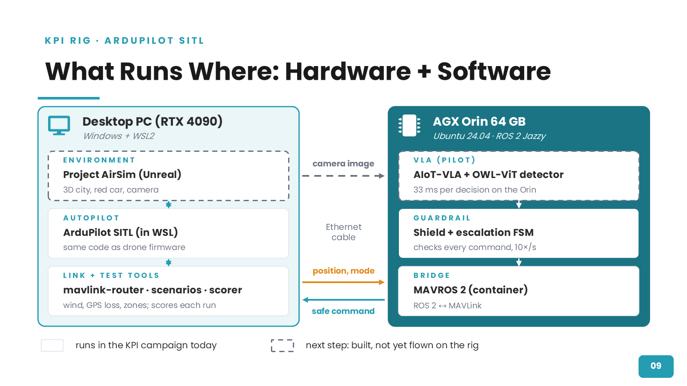

# Final Report

Semantic-Spatial Translation and Safety-Constrained VLA for ArduPilot UAVs ·
NTUT AIoT Lab · draft v0.3, 2026-11-14

> **Status: DRAFT, not signed.** Written from docs/FINAL-REPORT-outline.md at
> 2f22116; updated 14 Nov for the `hil` runs hs10 and ge1113, the CI on
> Python 3.12 and the committed KPI report (branch evidence-1114). The grant's final-delivery gate is 2026-11-30 (a signed final
> report, X-01). The signer and the signing CA are not named yet (PI, 12 Oct,
> Q5). Places that wait for a later number or a later decision are marked
> `TODO(...)`; no value is filled in for them. Every number below names the
> file or run it comes from.

## 1. Summary

- The Guardrail exists in the grant's four-part structure: a Policy DSL with
  a typed IR and signed bundles (WP1), a Prefix Compiler that emits a
  Constraint Summary Pack (WP2), a Safety Shield with an escalation FSM in
  front of ArduPilot (WP3), and a Stress Testing harness with a scenario
  library, episode bundles and a KPI report generator (WP4).
- Contract map (Appendix A, 136 obligations): **88 DONE, 41 PARTIAL,
  6 DRIFT, 1 MISSING**. DONE means the code or artefact the grant names
  exists and matches the grant's words; for a KPI row it means a KPI-grade
  value meets them.
- KPI-grade source: the nightly `hil` campaign ntFIN2 and its supplement
  ntFIN2s, both at 116214f, flown 12-13 Nov on the AGX Orin rig (section 5;
  CHANGELOG 2026-11-13 (the KPI-grade hil nightly ntFIN2 and its
  supplement)).
  - P0 violation escape rate **0.0**: 0 escapes on 16,760 P0-violation
    ticks over 586 Shield-on flights. Shield-off control: 0.6375.
  - Fail-safe trigger correctness **566/567 = 0.998** on the adopted reading
    (r2); Wilson 95 % lower bound 0.990. The other readings: (r) 554/567,
    (a) 495/567.
  - Shield tick (`tick_ms`): max 74.06 ms, 0 of 173,410 ticks over 100 ms.
  - Action receipt to setpoint (`e2e_ms`): p99 30.3 ms, max 121.93 ms;
    13 ticks over 100 ms, all the second tick of a mission. The fix
    (5f5009c) is on master; at the fixed commit 2f22116 the grant-example
    campaign ge1113 (36 KPI-grade missions) had 0 of 95,160 ticks over
    100 ms (max 66.37 ms) and the shakedown hs09 (17 missions) e2e max
    24.55 ms with P0 escapes 0 (section 5.6).
- Every edge of the grant's escalation ladder has flown on `hil`: G2, G4,
  G6, X2 and X3, the edges no rail had taken, in hs10 at 8a473fa on 14 Nov
  (section 4.3; CHANGELOG 2026-11-14 (hs10 ...)). WP3-07 stays PARTIAL:
  the grant names SET_MODE LOITER, and on `hil` the FSM's Loiter is held
  in GUIDED by the companion (section 9, decision 7).
- The KPI campaigns fly a stub pilot (guardrail/vla_stub.py). A learned
  model flew in the `hil` topology on 14 Nov: the lab's AIoT-VLA v10b on the
  AGX Orin, through MAVROS 2, with the Shield on (section 6;
  docs/data/pas_aiot_hil_20261114/flights.md). Seven missions, 0 P0 escape
  ticks in every one, 22-297 Shield interventions each; two of them
  KPI-grade (pas_hil_aiot_kpi_01: 420 s, 119 interventions, VLA 7.75
  decisions/s, camera to first setpoint p50 161.7 ms). Under perception
  stress, darkness breaks detection: at -4 EV no red car was found in 330 s
  and the mission refused to start.
- Follow quality on that rail is weak: target lock 0.04-0.82 against
  0.955-0.969 on simple_flight. The VLA stands still when the detector has
  no fresh box of the car (in pas_hil_aiot_kpi_01 its own command was 0 m/s
  at the median), and the city rail's target estimator and re-acquisition
  are not in the PAS node yet; `--identity` without that estimator lost
  the car after 107 s (pas_hil_aiot_kpi_02). Not a locked KPI; stated as a
  limitation (section 10).
- What this report cannot claim: a learned VLA deciding at 10 Hz (6.9-7.9
  decisions/s; ARCH-01, ARCH-03), observations at 10 Hz into the VLA (9.1-9.5
  Hz while it is asked; X-05, DRIFT), the `flight` topology (ARCH-14),
  Gazebo sweeps (WP4-04), CI per build or per release (WP3-19, WP4-06,
  WP4-14).

## 2. Scope and acceptance criteria

"KPI-grade" means `guardrail.manifest.is_kpi_grade` accepts the run (`hil`
or `flight` topology, sim_speedup 1.0, a clean code_revision), the signed
replay bundle beside the run verifies and is bound to it, and the campaign
accepted the flight (tools/kpi_report.py, "Definitions" section of its
output).

**The KPI-grade source.** Profile `nightly` at 116214f (clean), flown on the
AGX Orin rig: ArduCopter 4.5.7 SITL and mavlink-router on the desktop;
MAVROS 2, the Shield and the stub pilots on the Orin.

- ntFIN2: 744 episodes in the profile; 153 refused by the rail before
  flight (69 paraphrase / prefix arms the stub cannot read, 69 stressors SITL
  cannot realise, 15 others, among them an RTL that fails); 591 missions
  planned, 583 run folders, 580 KPI-grade episodes, 69,706 s of flying
  (demo/out/hil_ntFIN2/sweep.json; runs demo/out/hil_smoke/ntFIN2_*).
- The last 8 missions (wind-beyond-authority) never flew: the desktop ran
  out of commit memory (WinError 1455 / 1450). 3 gps-dropout flights were
  not accepted: the GPS denial was not applied in time (CHANGELOG
  2026-11-13).
- ntFIN2s re-flew the affected cells on all 3 seeds at the same commit and
  profile: 15 missions, 11 accepted; 4 superseded by an accepted ntFIN2
  flight of the same episode (demo/out/hil_ntFIN2s/sweep.json).
- Merged by one episode choice (`tools/kpi_report.py --campaign
  demo/out/hil_ntFIN2 --campaign demo/out/hil_ntFIN2s --rescore-rail
  <ntFIN2 table> --rescore-rail <ntFIN2s table>`): 594 episodes, 589
  KPI-grade (580 from ntFIN2, 9 from ntFIN2s; 586 Shield on, 3 Shield-off
  controls). Two cell-seeds have no accepted flight in either campaign:
  gps-dropout lane 15, window 6-13 s, seeds 1002 and 1003 (the denial's end
  applied 0.29-0.60 s late).

| KPI (grant) | Target | KPI-grade result (ntFIN2 + ntFIN2s) | Verdict |
|---|---|---|---|
| P0 violation escape rate (WP3-14) | 0 | 0.0000: 0 escapes on 16,760 P0-violation ticks, 586 Shield-on flights; Shield-off control 0.6375 (153 of 153 P0 ticks, 3 flights); passthrough null 0.2122 | meets |
| Fail-safe trigger correctness (WP3-15) | ≥ 0.99 | (r2, adopted): 566/567 = 0.998, Wilson 95 % low 0.990; (r) 554/567 = 0.977; (a) 495/567 = 0.873; 19 runs censored, not scored | meets as a point estimate |
| Monitor tick ≤ 100 ms end to end (WP3-13) | ≤ 100 ms | `tick_ms` p50 8.1 / p99 29.5 / max 74.06 ms, 0 of 173,410 over 100; `e2e_ms` p50 8.2 / p99 30.3 / max 121.93 ms, 13 over 100 | `tick_ms` within; `e2e_ms` 13 start-up ticks over (fixed after the campaign; at the fixed commit ge1113 had 0 of 95,160 over 100 ms, section 5.6) |
| Mean time to safe (WP3-17) | tracked | 3.35 s mean, max 10.90 s, over 172 recovered unsafe spells; 75 spells never recovered (counted, not averaged) | tracked |
| Repair success rate (WP3-20, X-02) | tracked | 98.1 % (26,521 of 27,025 repair ticks) | tracked |
| Mean repair magnitude (WP3-16) | tracked | 6.405 m/s (translational, pooled over repaired ticks; yaw rate apart) | tracked |
| Average repair count per episode (X-03) | tracked | 54.6 per Shield-on flight | tracked |
| Mission success rate (WP4-08) | tracked | 252/586 Shield on (our rule is stricter than the grant's: no dwell in a zone, no unsafe position entered, goal reached) | tracked |

Source of the merged figures: the KPI report generated on 13 Nov
(`tools/kpi_report.py`, two campaigns, two re-score tables), regenerated
on 13 Nov evening from a clean tree and committed:
docs/data/kpi_ntFIN2/kpi_report_ntFIN2_2026-11-13.md and .json, code
revision f505f1403bef, with the re-score tables beside it
(docs/data/kpi_ntFIN2/rescore_r2_ntFIN2.json, rescore_r2_ntFIN2s.json and
their .txt summaries; CHANGELOG 2026-11-13 (the final KPI report
committed)). The ntFIN2-only
figures are in docs/FINAL-REPORT-outline.md section 2 and CHANGELOG
2026-11-13 (3.23 s, 98.2 %, 252/577, 55.4).

Other locked KPIs, not from the nightly (docs/FINAL-REPORT-outline.md
section 2):

| KPI (grant) | Target | Evidence |
|---|---|---|
| DSL acceptance (WP1-19) | schema 100 %, golden 100 %, cold start ≤ 1 s, hot-apply ≤ 50 ms, query ≤ 5 ms | AGX Orin: cold start p95 590 ms, hot-apply p99 3.86 ms, query p99 0.977 ms; schema and golden 100 % (docs/data/wp1_roundtrip.json) |
| Policy load round-trip (WP1-17) | 100 % | round-trip 32/32, tamper 32/32, negative corpus 39/39 refused (docs/data/wp1_roundtrip.json, 6 Nov, clean tree 4edd5d1) |
| Bundle replayability (WP1-18) | load the bundle whose hash matches | hil_smoke_03 (KPI-grade): its signed replay bundle verifies and re-derives its KPIs |
| Prefix-token budget (WP2-02) | budget respected, CSPBudgetExceeded on overflow | docs/data/csp_kpis.json; tests/test_csp.py |
| CSP P0 coverage (WP2-03) | 100 % | 122/122 P0 at 256 tokens and at 144 tokens (docs/data/csp_kpis.json, 6 Nov, clean tree 52ac56c) |
| Per-paraphrase robustness (WP4-09) | stability across paraphrases | 7/8 with OpenVLA-7B on one AirSimNH mission (7 Nov, not KPI-grade); no `hil` value: the `hil` pilot reads no text |

## 3. System architecture and topologies

- **Action contract.** A 4-D body-frame action (vx, vy, vz, yaw_rate) at
  10 Hz (ARCH-05, WP3-03: DONE). Since 4 Nov the Shield takes and returns the
  body frame at its own boundary (`Shield.filter_body`); body to local NED
  happens only in sitl/mavlink_adapter_node.py on the ROS 2 rail. The dev
  rails still hand the Shield world-frame actions (WP3-04, ARCH-04:
  PARTIAL). No learned VLA has emitted the 10 Hz setpoint stream into
  ArduPilot (ARCH-01).
- **Pipeline.** Bundle → CSP → pilot → Shield (+ FSM) → MAVROS 2 →
  ArduPilot, with ArduPilot's GeoFence as the last backstop, set by the GCS
  since 3 Nov (WP3-10, ARCH-09).
- **AP_DDS (ARCH-08).** The optional Q3 migration to ArduPilot's AP_DDS was
  deferred: no AP_DDS code exists, and MAVROS 2 remains the ROS 2 bridge to
  ArduPilot.
- **Topologies** (ARCH-11 to ARCH-14):

| Topology | Grant definition | State on 2026-11-13 |
|---|---|---|
| `dev` | everything on one desktop | flown: SITL + MAVROS 2 (7 Oct); PAS + ArduPilot + MAVROS 2 in WSL, `pas_dev_mavros_02` (29 Oct); Gazebo over pymavlink and MAVROS 2 (2 Nov). A `dev` run counts for KPIs only with the PI's written waiver. |
| `hil` | desktop runs the simulators, MAVROS and the GCS; the Orin runs the VLA and the Shield | flown since 6 Nov on the AGX Orin: SITL and mavlink-router on the desktop; MAVROS 2, the Shield and the stub pilot on the Orin. First KPI-grade run hil_smoke_03; KPI-grade nightly ntFIN2. A learned VLA on this rail: not flown (ARCH-20). |
| `flight` | Orin companion on a real ArduPilot drone | not flown. The drone cannot carry an AGX Orin; needs the PI's written waiver (ARCH-14). |

- **Rails.** ArduPilot SITL + MAVROS 2 (the KPI rail); Project AirSim +
  ArduPilot (the perception rail); Project AirSim CityLife with
  simple_flight (the follow comparisons, outside the ArduPilot architecture,
  ARCH-02); Gazebo Harmonic (flown end to end on 2 Nov, no sweep, ARCH-16).

*What runs where in the `hil` topology (the 11 Nov progress-deck figure): the desktop PC runs Project AirSim and ArduPilot SITL 4.5.7 with mavlink-router and the scenario tools; the AGX Orin runs the pilot (AIoT-VLA with its OWL-ViT detector, or the stub), the Shield with its escalation FSM, and MAVROS 2 in the companion container. The dashed boxes (Project AirSim, AIoT-VLA) were built but not yet flown on the rig when it was drawn; they flew on 14 Nov (section 6; docs/data/pas_aiot_hil_20261114/flights.md). The KPI campaigns fly the solid boxes with the stub pilot.*

## 4. Results by work package

Each subsection: what was delivered, what is built differently, what
remains. The per-obligation rows are in Appendix A.

### 4.1 WP1 Policy DSL and IR (25 obligations)

- Delivered: the IR with a spatial index, fences, corridors, time windows,
  breach actions, priorities, layered merge, ingest tools, the round-trip
  KPI (WP1-17), the replayable bundle (WP1-18, hil_smoke_03) and the DSL
  benches on the AGX Orin (WP1-19).
- ConstraintBase requires the grant's four fields since IR schema 4.0.0
  (6 Nov; `scope` was the last, WP1-01). Every shipped rule states
  `scope: mission` (CHANGELOG 2026-11-06 (IR 4.0.0)).
- Since 3 Nov every shipped policy is stored and hashed in WGS84 with a lazy
  local view (WP1-14); distance_envelope is enforced for buildings, roads and
  the tracked person (WP1-07).
- Built differently: the 20 July gate was missed; the IR was first committed
  2026-10-06 (WP1-21, DRIFT).
- Open: the signing authority (WP1-04); compatibility with the PI's
  reference implementation (WP1-05); distance_envelope for people other than
  the tracked subject (WP1-07); the metre read form still accepted (WP1-14);
  the perception rail's hot-apply listener (WP1-15); one Project AirSim
  scene step on Python 3.12 (WP1-25: the desktop's non-VLA side moved to
  3.12 on 14 Nov, section 7).

### 4.2 WP2 Prefix Compiler (19 obligations)

- Delivered: the CSP model and schema, the token budget (WP2-02), P0
  coverage (WP2-03), relevance explanations, the adapters, templates and
  tests. The paraphraser is a separate gRPC service with mutual TLS since
  2 Nov (WP2-13).
- On 7 Nov OpenVLA-7B flew with the CSP in its prompt: an A/B on three seeds
  and eight paraphrases from the paraphraser service (AirSimNH, not
  KPI-grade). WP2-01, WP2-09, WP2-18 and WP4-10 became DONE. On base
  OpenVLA the CSP's effect on repairs is no larger than a rule-free
  prefix's (CHANGELOG 2026-11-07 (CSP flights)).
- The WP2 and WP4 correction notes were approved by the PI on 6 Oct and
  sent to ITRI (confirmed 2 Nov; WP2-12, WP4-21).
- Open: one Project AirSim scene step on Python 3.12 (WP2-19, as WP1-25).

### 4.3 WP3 Safety Shield (24 obligations)

- Delivered: monitor / filter / projection (WP3-02), the 10 Hz ROS 2
  interface (WP3-03), the REST listener driven in flight (WP3-12), one flown
  zone per breach action (WP3-08), the audit record with the grant's fields
  (WP3-11, shield_audit.jsonl), the node architecture (WP3-23), the IR
  invariant (WP3-21), the package (WP3-24).
- KPI-grade on `hil` (ntFIN2): P0 escape rate 0 (WP3-14); the tracked KPIs
  repair magnitude, time to safe and repair success (WP3-16, WP3-17,
  WP3-20).
- Escalation FSM edges taken in ntFIN2 (from each run's metrics.json `fsm`;
  Appendix A WP3-07): G1 348, G3 334, G5 253, G9 216, X1 146, G7 93, G8 64,
  X5 54, G11 18, G10 3, G12 3, X4 3, X9 1. X6, X7 and X8 flew on `hil`
  before (rh01, rh03, 6-7 Nov).
- The edges no rail had taken flew on 14 Nov in hs10 (8a473fa, `hil`,
  profile `fsm_edges`, one seed per cell; demo/out/hil_hs10/sweep.json, runs
  demo/out/hil_smoke/hs10_*; CHANGELOG 2026-11-14 (hs10 ...)): G2 and G4 on
  fsm-n-in-t-flicker (hs10_003: X1, G2 at 5.8 s "N-in-T: 3 onsets in 5 s",
  G4 at 10.0 s, RTL, G9); X2 (hs10_001) and X3 (hs10_002) from a hold; G6
  on a blocked leg home (hs10_004: G11, G6, G10) and on no progress home
  under wind beyond authority (hs10_005: G1, G3, X9, G6, G10; no progress
  home is our RTL-failure reason, not one the grant names). G6's input is
  the node's RTL watch (`RTLFailureWatch`, sitl/ros2_shield_node.py;
  CHANGELOG 2026-11-14 (WP3-07)), which replaced `rtl_failed=False`: the
  Shield's check of the leg home against its hard P0 zones, and progress
  home while ArduPilot reports RTL. P0 escape 0 and 0 polygon entries over
  the 5 missions; `e2e_ms` max 41.3 ms over 423 setpoint ticks (2,181
  rows).
- The Loiter is not SET_MODE LOITER on `hil`: since 7 Nov the companion
  holds it in GUIDED (node default `--hold-flight guided`,
  sitl/ros2_shield_node.py:2811-2817, :5681); hs10_003 logs "LOITER held
  in GUIDED by the companion" at t = 5.828 s with mode requests ["RTL"];
  ntFIN2 has 337 Loiter entries (G3 334, X4 3) and 0 LOITER requests (RTL
  272, LAND 290, GUIDED 64). The campaign was planned, driven and scored on Python
  3.12 (sweep.json `_runner`).
- Built differently: the mid-term Shield node came after the 20 July gate
  (WP3-01, DRIFT); PathRepair is off by default, a measured deviation
  (WP3-06); the PAS rail bypasses the MAVLink adapter (WP3-09); planning
  and analysis code still measures zone geometry of its own (WP3-22).
- Open: WP3-07 stays PARTIAL: SET_MODE LOITER is driven on no `hil` flight
  (the GUIDED hold awaits decision 7, section 9); G6's battery reason is not
  flown (failsafe-low-battery stays refused: SITL reaches CRITICAL only
  through BATT_CRT_* thresholds the rig leaves at 0); fsm-n-in-t-flicker is
  unlabelled (the rubric's N1 expects no fail-safe where the grant's G4
  sends the aircraft home; decision 13); fail-safe correctness on the 19 censored runs and 2
  unaccepted cell-seeds (WP3-15); the smoke matrix per build (WP3-19).

### 4.4 WP4 Stress Testing (21 obligations)

- Delivered: the scenario library (WP4-02), the KPI report generator
  (WP4-07), the Shield audit in every harness bundle (WP4-20), mission
  success on `hil` (WP4-08), the six-field manifest on every KPI-bearing
  run (WP4-12), the paraphrase arms through the service (WP4-10).
- The grant's worked example (`grant_example` profile, 36 episodes) flew on
  `hil` as ge1110 at 9eed35b: 32 missions flew and reached W3 with no repair
  and no unsafe spell; 4 died before the mission began, a fence-raise race
  fixed in 183bb3e (CHANGELOG 2026-11-11 (hil rig flights, 7-11 Nov) and
  (fence read and take-off)). Its "mean time to safe ≤ 2.0 s" holds only
  vacuously: no episode is ever unsafe (CHANGELOG 2026-11-07 (grant example
  sweep)). The same sweep flew again at 2f22116 as ge1113 (13-14 Nov, 36
  missions, all KPI-grade; demo/out/hil_ge1113/sweep.json; CHANGELOG
  2026-11-14 (hs10 ...)): 36 passed, mission success 27/36, no
  P0-violation tick, no repair and no unsafe spell, so its P0 rate is
  vacuous and its fail-safe labels (36/36, all "no fail-safe") do not
  discriminate (`tools/kpi_report.py --campaign demo/out/hil_ge1113`, not
  committed). It is latency evidence at the fixed commit (section 5.6), not
  Shield evidence.
- Built differently: the smoke set has never run per release (WP4-14).
- Open: the KPI report's delivery with this report (WP4-17; the report
  itself is committed, section 2); the zone edits translate, rotate
  and scale driven by the harness into a flight (WP4-03); Gazebo functional
  sweeps (WP4-04); the gRPC harness driving a rail episode (WP4-05); CI
  smoke per build and a nightly cadence (WP4-06); the grant's bundle names
  from a flown rail session (WP4-11); the prefix A/B in the stress harness
  with a text-reading pilot (WP4-15); perception-stress scenarios on Project
  AirSim (WP4-16, WP4-18); the final demo gate (WP4-19).

## 5. KPI report (WP4-17)

### 5.1 Source

The nightly `hil` campaign ntFIN2 and its supplement ntFIN2s at 116214f
(section 2). Every flown episode is re-scored from its own log with
`guardrail.kpi.compute`, the function the flights use. Fail-safe labels come
from the committed label artefact docs/data/failsafe_labels_rail.json,
re-scored with `experiments/sweep_scenarios.py --profile nightly
--rescore-rail`.

### 5.2 P0 violation escape rate

- 0.0000 over 586 Shield-on flights: 0 escapes on 16,760 P0-violation
  ticks.
- Shield-off control (nfz-head-on-control, 3 flights): 0.6375, 153 escapes
  on 153 P0 ticks. Passthrough null: 0.2122.
- The count is the Shield's own log, as the grant defines it ("Counter from
  Shield repair log"). On the true position, in 21 Shield-on ntFIN2 missions
  ArduPilot carried the aircraft into a P0 zone: 18 GeoFence breaches with
  RTL where a zone appeared 3 m ahead, and 3 RTL legs through a
  time-windowed zone (docs/FINAL-REPORT-outline.md, independent-review
  note, point 2). In the merged report's table "What the autopilot flew on
  the rail runs", the three supplement missions ntFIN2s_013-015
  (wind-beyond-authority, lane 20, 12 m/s) each show one autopilot keep-out
  breach and one polygon entry; demo/out/hil_ntFIN2s/sweep.json
  `_true_state` counts them as 3 autopilot-entered P0 polygons, so 24 of
  the 586 merged Shield-on flights. This is the RTL drift in a 12 m/s wind
  that the shakedown hs07 first showed; it is open.

### 5.3 Fail-safe trigger correctness

| Reading | Correct / scored | Point (the KPI) | Wilson 95 % low | Nulls: always / never |
|---|---|---|---|---|
| (a) ideal-vehicle labels | 495/567 | 0.873 | 0.843 | 0.400 / 0.600 |
| (r) rail-vehicle labels | 554/567 | 0.977 | 0.961 | 0.476 / 0.524 |
| **(r2) rail-vehicle labels, E5 on the prescribed flight (adopted)** | **566/567** | **0.998** | **0.990** | 0.497 / 0.503 |

- The one miss under (r2) is ntFIN2_177 (dyn-nfz-spawn-ahead, label E5).
- 19 runs ended still holding in Loiter and are censored, not scored: 18
  dyn-nfz-spawn-ahead (ntFIN2_178-186, ntFIN2_214-222) and
  ntFIN2_374_corridor-swap-shifted.
- On the labels the main campaign flew with, ntFIN2 scored 498/558 = 0.892.
- (r2) was adopted on 10 Nov (docs/RUBRIC-failsafe.md sections 7-8; CHANGELOG
  2026-11-10 (fail-safe labels adopted)), after earlier rig flights had been
  scored on another reading. The adoption and the gps-dropout label
  re-derivation (12 Nov) were committed before ntFIN2 flew; neither was
  pre-registered.

### 5.4 Tick budget

| Measure | Ticks | p50 | p95 | p99 | Max | Over 100 ms |
|---|---|---|---|---|---|---|
| `tick_ms` (tick start to setpoint) | 173,410 | 8.09 | 24.94 | 29.47 | 74.06 | 0 |
| `e2e_ms` (action receipt to its first setpoint) | 173,410 | 8.23 | 25.24 | 30.30 | 121.93 | 13 |

- The 13 ticks over 100 ms are each row 2 of its mission at t = 0.101 s. A
  pilot message queued during the node's ~90 ms `start_mission` work was
  delivered after t = 0; the next message was then deferred to the poll
  80-86 ms later (CHANGELOG 2026-11-13 (the start-up tick)).
- "End to end" starts at the Shield node's receipt of the pilot's message,
  not at a camera frame. `cam_age_ms` and `cam_to_setpoint_ms` are not
  measured on this rail: no camera is in the `hil` stub loop.
  Measured 14 Nov with AIoT-VLA on the AGX Orin (docs/data/pas_aiot_hil_20261114/flights.md): camera frame arrival to the first setpoint p50 159-163 ms, p99 282-296 ms over six missions; the VLA's own inference (capture to answer p50 0.110-0.113 s) and the detector account for it, the monitor tick stays within budget.
- AGX Orin profile (6 Nov, 50 rules x 51 poses): query p99 0.977 ms, Shield
  step p99 22.647 ms (deploy/evidence/hil/shield_tick_profile.json).

### 5.5 Tracked KPIs per family (Shield on, KPI-grade)

| Family | Episodes | Mission success | Mean time to safe (s) | Repairs / ep | Repair magnitude (m/s) | Repair success |
|---|---|---|---|---|---|---|
| all Shield-on flights | 586 | 252/586 | 3.35 (max 10.90), +75 never recovered | 54.6 | 6.405 | 98.1 % |
| altitude_envelope | 21 | 18/21 | 3.22 | 28.2 | 1.968 | 99.0 % |
| corridor_keep_in | 42 | 12/42 | never unsafe | 193.3 | 5.452 | 99.4 % |
| corridor_swap | 9 | 0/9 | 1.93 | 24.0 | 2.396 | 89.4 % |
| dynamic_nfz_movement | 165 | 21/165 | 3.04, +18 never recovered | 26.0 | 3.289 | 94.7 % |
| failsafe_escalation | 24 | 0/24 | 0.47, +3 never recovered | 1.0 | 4.000 | 0.0 % |
| high_speed_near_edge | 90 | 90/90 | never unsafe | 175.3 | 7.665 | 100.0 % |
| kinematic_envelope | 3 | 3/3 | never unsafe | 300.7 | 16.000 | 100.0 % |
| radius_scaling | 15 | 6/15 | 3.79 | 6.1 | 5.657 | 83.5 % |
| sensor_degradation | 22 | 12/22 | never unsafe | 9.2 | 5.577 | 95.0 % |
| static_nfz | 6 | 0/6 | never unsafe | 5.0 | 6.044 | 62.5 % |
| subject_standoff | 60 | 48/60 | never unsafe | 3.8 | 3.642 | 89.6 % |
| three_simultaneous_violations | 54 | 0/54 | 3.45, +54 never recovered | 8.0 | 10.294 | 0.0 % |
| time_window_static | 6 | 3/6 | never unsafe | 1.0 | 5.656 | 0.0 % |
| time_window_switch | 51 | 36/51 | 3.86 | 20.1 | 1.859 | 77.3 % |
| wind_disturbance | 18 | 3/18 | 7.78 (max 10.90) | 5.2 | 5.656 | 83.9 % |

Nulls: a hover passes 0.0 % of the missions; an always-brake Shield's repair
success is 0.0 %. The ten worst failures are all
three-simultaneous-violations missions (unsafe never recovered), each linked
to its signed replay bundle in the KPI report.

### 5.6 After the campaign: the start-up fix

- Fix: 5f5009c (the node delivers its start-up backlog before t = 0 and
  holds it), merged to master in d7bb6a2.
- Shakedown hs09 at 2f22116 (`hil`, sim_speedup 1.0, clean revision
  2f221168625c): nfz-head-on, corridor-drift-angles and
  wind-beyond-authority, seed 1001; 22 episodes planned, 5 paraphrase /
  prefix arms refused, 17 missions flown (demo/out/hil_hs09/sweep.json;
  runs demo/out/hil_smoke/hs09_*).
- Result over 7,083 ticks: `e2e_ms` p99 16.75 ms, max 24.55 ms; `tick_ms`
  max 24.46 ms; no tick over 100 ms; row 2 of all 17 missions ticked on the
  action; P0 escape rate 0 on every Shield-on mission.
- hs09 is a shakedown of three templates, not the nightly. On the labels it
  flew with, one cell failed (hs09_001, nfz-head-on canonical arm: labelled
  not to trigger, triggered RTL). Re-scored with the label artefact
  (`experiments/sweep_scenarios.py --profile nightly --rescore-rail`; output
  docs/data/kpi_ntFIN2/rescore_r2_hs09.json): (r2) 17/17 = 1.000, Wilson 95 % low 0.816;
  (r) 17/17; (a) 16/17 = 0.941, the false trigger hs09_001. Under (r) and
  (r2), hs09_001's label is read on the cell flown as long as the rail
  flies; without it 16/16.
- A full campaign at the fixed node code (5f5009c; the Shield code is
  unchanged from 116214f, the diff touches only the node's start-up path),
  unloaded: the grant-example sweep ge1113 at 2f22116 (`hil`, 36 missions,
  all KPI-grade, 3 rules plus one hot-applied zone, 0 repairs, 0 Brake
  ticks; demo/out/hil_ge1113/sweep.json;
  `tools/kpi_report.py --campaign demo/out/hil_ge1113`, committed as docs/data/kpi_ge1113/kpi_report_ge1113_2026-11-14.md, code revision 181b75cdaad3):
  over 95,160 ticks `tick_ms` p50 7.2 / p95 8.7 / p99 9.8 / max 66.28 ms and
  `e2e_ms` p50 7.3 / p95 8.8 / p99 9.8 / max 66.37 ms; 0 ticks over 100 ms;
  each mission's maximum is its hot-apply tick.
  Its missions never came near a zone (no P0-violation tick, no repair), so
  it shows the tick budget at the fixed commit and nothing about the
  Shield's other KPIs (section 4.4).
- Loaded: hs09 (above, 7,083 setpoint ticks) e2e max 24.55 ms; hs10 at
  8a473fa (section 4.3) e2e max 41.3 ms over 423 setpoint ticks (2,181
  rows); ntFIN2 (116214f, the same Shield code) e2e max 74.14 ms outside
  the start-up rows (ntFIN2_364).
- `e2e_ms` spans the Shield node only, from the /vla/action_4d callback to
  /shield/setpoint; the pilot's DDS hop and the adapter's hop to MAVROS are
  not in it (the adapter hop, read from the runs' bags, is about 1.3 ms p50,
  2 ms p99). Every `hil` figure has the stub as pilot and no VLA on the
  Orin; ~50 rules appear only in the offline Orin profile (d0e91bb, 6 Nov,
  MAVROS stopped, not re-run at 2f22116). Re-run 14 Nov at bc04e4a: the ~50-rule Orin profile (MAXN, clocks not locked, MAVROS stopped; deploy/evidence/hil/shield_tick_profile_20261114.json) _check p99 0.994 ms (max 1.056, 0 of 1,301 over 5 ms), filter p99 26.709 ms (max 48.814); the loaded cells at the fixed node code: hs11 (bc04e4a, dyn-nfz-spawn-ahead, 16 KPI-grade missions of a 55-mission plan stopped by the launcher's time limit, the 17th incomplete) e2e p99 37.1 / max 66.08 ms over 5,121 ticks, and the harness-driven hh02 (bc04e4a, 6 missions incl. radius-scaling-grow-deep) e2e p99 26.9 / max 83.57 ms over 2,669 ticks, its maximum a REST scale tick; 0 over 100 ms in either. three-simultaneous-violations was not reached in hs11.
- WP3-13 is DONE on these runs (Appendix A). ntFIN2's 13 start-up ticks
  stay in sections 5.4 and 5.7 and in its committed KPI report as flown,
  before the fix.

### 5.7 Read with care

1. **The pilot.** Every KPI-grade run flies a stub (GotoPilot,
   ConstantPilot, StubVLA). The figures measure the Shield and its FSM in
   front of ArduPilot SITL under scripted commands, not a learned model.
2. **Independence.** No flown cell consumes its seed. A cell's three seeds
   are three flights of one deterministic scenario that differ only by the
   rig's timing: 389 distinct KPI signatures over 580 ntFIN2 episodes. The
   rates and the Wilson bound count them as independent.
3. **Coverage.** 153 of 744 profile episodes were refused before flight.
   The refused set includes the RTL that fails, G6's scenario.
4. **Definitions.** Repair magnitude leaves the yaw rate out; mission
   success is stricter than the grant's; time to safe averages only the
   recovered spells; theta judges about a third of the converged repair
   ticks.
5. **Provenance.** The merged report was generated from a tree with
   uncommitted changes and lives outside the repository (TODO above).
6. **Lost missions.** A first attempt at the same commit, ntFIN (stopped
   at 176 of 591 missions when the session ended), is not in the figures;
   its runs are kept (demo/out/hil_smoke/ntFIN_*).

## 6. VLA backend measurement set (ARCH-30, X-04)

The grant asks for a measurement set before a default VLA backend is
chosen. The protocol table in the repository
(deploy/evidence/vla_backend_table.md, `vla-backend-protocol/1`) still
says "Default backend: none" and has empty Orin columns. This section folds
into it the follow comparison of 27-29 Oct, the AGX Orin timings of 3-6 Nov
and the lab's own AIoT-VLA.

All follow flights are on Project AirSim CityLife with simple_flight:
outside the ArduPilot architecture (ARCH-02) and never KPI evidence. The
score is the share of the mission within 30 m of the red car: hierarchical
flights (the VLA chooses the intent, the hand-written controller flies it)
from the start gate, end-to-end flights from the first acquisition
(CHANGELOG 2026-10-28).

### 6.1 Protocol table

| Backend | Host, precision | Decision time | Follow, hierarchical | Follow, end to end | Sources |
|---|---|---|---|---|---|
| Stub P-controller (no model; the KPI campaigns fly stub pilots) | desktop | p50 0.0013 ms (n=50) | - | - | [T] |
| Hand-written follow (OWL-ViT + controller; no VLA) | PC; AGX Orin | - | PC 0.972 (n=5, std 0.012); AGX 0.952 (n=1) | - | [C29] [C4] |
| AerialVLA original (OpenVLA-7B + LoRA) | PC RTX 4090, bf16 / sdpa / merged | bench p50 259 ms; in flight 0.49-0.63 s p50 | 0.854 (n=5, std 0.305; median 0.987) | 0.539, 0.153 | [T] [C29] [C28] |
| AerialVLA original | AGX Orin, bf16 / sdpa / merged | bench p50 1073.9 ms (n=50; unmerged 1520.3 ms); in flight 1.44 s | 1.000 (n=1) | 0.048 | [E1] [C4] |
| AerialVLA QLoRA fine-tunes r1-r4 | PC, bf16 / sdpa / merged | in flight 0.48 s (r1), 0.66 s (r3) | 0.882-0.917 (n=2-3 each) | 0.018-0.065 | [C27] [C29] [C28] |
| DroneCATS-2B | PC, bf16 | bench p50 1.00-1.12 s; in flight 1.45 s | 0.933 (n=5, std 0.006) | 0.132, 0.086 | [C27] [C29] [C28] |
| DroneCATS-2B | AGX Orin, bf16 | in flight 2.64 s | 0.941 (n=1) | 0.000 | [C4] |
| DroneCATS-2B | Orin Nano, int4 | 9.6 s; beside the detector it timed out 34 of 36 times | - | - | [C28n] |
| RaceVLA-7B | PC | bench nf4 0.33 s; in flight 0.40-0.42 s | 0.720 (n=2) | 0.099, 0.084 | [C27] [C28] |
| RaceVLA-7B | AGX Orin, bf16 | in flight 1.22 s | 0.715 (n=1) | 0.055 | [C4] |
| OpenVLA-7B (base; reads the CSP prompt) | AGX Orin, bf16 | median 0.975 s (8 answers, timed after the first) | not flown on the follow | not flown on the follow | [C3e] |
| OpenVLA-7B (base) | desktop, nf4 / bf16 | warm 0.86 s / 3.35 s (load probes, 14 Jul, n far below 50) | - | - | [T] |
| AIoT-VLA (the lab's own: frozen OWL-ViT + trained head; reads the object's words, not the CSP) | RTX 4090 (v1) | model time p50 10.3 ms | - | v10b with the stand-off feed, red car: 0.969, 0.960, 0.955 (n=3, P0 escape 0.0) | [D] [C1] |
| AIoT-VLA | Orin Nano Super (v1) | model time p50 48.4 ms (600 captures, server alone) | - | - | [D] |
| AIoT-VLA v10b | AGX Orin, fp16 | model time p50 32.6 ms, round trip p50 39.6 ms (n=300, server alone) | - | Flown 14 Nov (docs/data/pas_aiot_hil_20261114/flights.md): pas_hil_aiot_kpi_01 (KPI-grade, 420 s, 119 interventions, P0 0) and five perception-stress missions. | [E2] |
| CognitiveDrone, BitVLA (named by the grant) | - | weights not obtained | - | - | [T] |

Sources:

- [T] deploy/evidence/vla_backend_table.md (generated 2026-10-06; the
  AerialVLA serving section 2026-10-21 from docs/data/aerialvla_serving_4090.json).
- [C1] CHANGELOG 2026-11-01 (late): runs aiot_v10bs_01-03; flown from the
  clean master 55faad0, signed copies in bundles/ (CHANGELOG 2026-11-06
  (contract)).
- [C27] CHANGELOG 2026-10-27 (flown): runs `demo/out/cmp_*`.
- [C28] CHANGELOG 2026-10-28: runs `cmp2_*` and the Orin Nano client runs.
- [C28n] CHANGELOG 2026-10-28 (night).
- [C29] CHANGELOG 2026-10-29 (later): runs `rep3_*` to `rep5_*`.
- [C3e] CHANGELOG 2026-11-03 (evening): deploy/orin/vla_bf16_check.py,
  verdict in deploy/evidence/hil/vla_bf16_check.json.
- [C4] CHANGELOG 2026-11-04: the 28 Oct matrix re-flown with every VLA
  served on the AGX Orin (MAXN, 6da813d).
- [D] docs/DESIGN-aiotvla.md ("On the Jetson Orin Nano", the serving check).
- [E1] deploy/evidence/hil/aerialvla_serving_bench_agx_merged.json and
  aerialvla_serving_bench_agx.json.
- [E2] deploy/evidence/hil/aiotvla_v10b_bench_agx.json (6 Nov).

Read with care: one to five flights per configuration; the AIoT-VLA
flights (1 Nov) used the stand-off feed added that day, so they are not
the same configuration as the 27-29 Oct matrix; a server-alone time leaves
out the camera, the detector and the transport.

### 6.2 Flights per configuration, 27-29 Oct

On the PC the whole loop ran on the desktop. On the Orin Nano only the
flight client ran on the board; every VLA answered from the desktop's GPU
(CHANGELOG 2026-10-28, Limits). n is the number of flights, std the sample
standard deviation.

| Platform | Mode | Model | n | Mean | Std | Min-max |
|---|---|---|---|---|---|---|
| PC | controller | fixed 12 m stand-off (no VLA) | 1 | 0.999 | - | 0.999 |
| PC | controller | hand-written follow (no VLA) | 5 | 0.972 | 0.012 | 0.954-0.983 |
| PC | hierarchical | DroneCATS-2B | 5 | 0.933 | 0.006 | 0.928-0.940 |
| PC | hierarchical | AerialVLA FT r2 | 2 | 0.917 | 0.002 | 0.915-0.918 |
| PC | hierarchical | AerialVLA FT r3 | 3 | 0.897 | 0.034 | 0.869-0.934 |
| PC | hierarchical | AerialVLA FT r1 | 3 | 0.882 | 0.003 | 0.879-0.884 |
| PC | hierarchical | AerialVLA FT r4 | 2 | 0.882 | 0.013 | 0.873-0.891 |
| PC | hierarchical | AerialVLA (original) | 5 | 0.854 | 0.305 | 0.309-0.999 |
| PC | hierarchical | RaceVLA-7B | 2 | 0.720 | 0.001 | 0.719-0.721 |
| PC | pure VLA | AerialVLA (original) | 2 | 0.346 | 0.273 | 0.153-0.539 |
| PC | pure VLA | DroneCATS-2B | 2 | 0.109 | 0.033 | 0.086-0.132 |
| PC | pure VLA | RaceVLA-7B | 2 | 0.091 | 0.011 | 0.084-0.099 |
| PC | pure VLA | AerialVLA FT r1-r4 | 1 each | 0.018-0.065 | - | - |
| Jetson | hierarchical | AerialVLA (original) | 1 | 0.989 | - | - |
| Jetson | controller | hand-written follow (no VLA) | 1 | 0.976 | - | - |
| Jetson | hierarchical | DroneCATS-2B | 1 | 0.969 | - | - |
| Jetson | hierarchical | AerialVLA FT r1-r4 | 1 each | 0.876-0.924 | - | - |
| Jetson | controller | fixed 12 m stand-off (no VLA) | 1 | 0.799 | - | - |
| Jetson | hierarchical | RaceVLA-7B | 1 | 0.704 | - | - |
| Jetson | pure VLA | all seven models | 1 each | 0.017-0.113 | - | - |

How to read it:

- AerialVLA original, hierarchical, scored 0.979-0.999 in four of its five
  PC flights and 0.309 in one (`cmp2_hier_aerovla`): the detector lost the
  car after a corner. Its median is 0.987.
- In hierarchical mode the VLA's only lever while the car is locked is the
  stand-off, and the score falls with the stand-off. A fixed 12 m
  controller is the ceiling on the PC.
- No VLA beats the hand-written controller consistently. The fine-tuned
  AerialVLA runs (r1-r4) sit below the original in both modes.

### 6.3 AGX Orin

The AGX Orin replaced the Orin Nano as the `hil` machine on 3 Nov
(CHANGELOG 2026-11-03 (evening), (night), (late night) and 2026-11-04).

- OpenVLA-7B unquantized in bf16 on the board: median 0.975 s per action;
  OWL-ViT at 61 ms per frame (192 ms on the Orin Nano).
- The first follow flown from the AGX Orin (`agx_follow_01`, hand-written
  controller): 0.952 within 30 m, detector 2.57 Hz.
- AerialVLA unmerged on the board: 1.52 s per decision; hierarchical follow
  0.988; end-to-end follow 0.213 with one P0 escape against a phantom
  subject (the phantom is refused on replay since 4 Nov).
- The 28 Oct matrix re-flown with every VLA served on the AGX: the served
  latency was 2.1 to 3.9 times the Nano matrix's (median 2.4); over the six
  hierarchical VLA models flown in full on both, the mean score is 0.888 on
  the AGX and 0.891 on the Nano.

AIoT-VLA v10b on the AGX Orin in the hil topology, 14 Nov (docs/data/pas_aiot_hil_20261114/flights.md): six missions, Shield on, 0 P0 escape ticks, 22-297 interventions per mission, VLA decisions 6.9-7.9 Hz, camera to first setpoint p50 about 160 ms; one KPI-grade mission (pas_hil_aiot_kpi_01). Follow quality is weak on this rail (target lock 0.04-0.82, docs/data/pas_aiot_hil_20261114/perception_stress_report.md), well below its 0.955-0.969 on simple_flight.

### 6.4 Default backend: PI to choose

The choice is the PI's (ARCH-30, X-04; section 9, item 12).

**Recommendation: AIoT-VLA v10b as the default for the follow mission on
the perception and `hil` rails, with OpenVLA-7B kept as the text-reading
backend for the CSP experiments (WP2).**

Reasons:

- It is the only learned model in the table that holds the car end to end:
  0.955-0.969 within 30 m over 3 flights. Every other model flown end to
  end (the published models and our AerialVLA fine-tunes) scored
  0.000-0.539.
- It is the only one whose decision time on the AGX Orin fits inside the
  grant's 100 ms tick: 32.6 ms p50, server alone. The other learned models
  served on the board took 0.975 s (OpenVLA-7B bench) to 2.64 s
  (DroneCATS-2B in flight) per decision.
- In hierarchical mode no VLA beats the hand-written follow consistently
  (CHANGELOG 2026-10-28), so a larger model buys no score there.

Against it:

- It reads the object's words, not the CSP, so it cannot carry WP2's
  prefix. That is why OpenVLA-7B stays for the CSP A/B.
- It is trained on CityLife follows of a few targets.
- Its flights so far are on simple_flight; it has not flown on `hil`
  (TODO above).
- The grant's reference backends (CognitiveDrone, BitVLA) were not
  obtained, so they are not in the comparison.

## 7. Deviations register

| Item | Grant | What we do | State |
|---|---|---|---|
| WP1-25, WP2-19, X-06 | Python 3.11+ | the AGX Orin companion runs Python 3.12.3 on every `hil` flight; since 14 Nov the desktop's non-VLA side runs Python 3.12.16 (guardrail-py312): the full CI at 8a473fa, 148/148 files (docs/data/ci_local/8a473fa0172e-py312.json), the `hil` campaign hs10 planned, driven and scored by it (sweep.json `_runner`), and the PAS launcher's scene / check / g1 steps (scripts/run_pas_ardupilot.ps1, not yet run on a live scene); vla-real (Python 3.10.20) stays for the VLA runtime (torch, transformers), which the grant scopes out of the 3.11+ decision (docs/DESIGN-python-versions.md) | one PAS scene step on 3.12; the PI to confirm that the VLA runtime is outside the floor |
| WP1-14 | WGS84 canonical, ENU/NED computed lazily | all 32 shipped policies stored and hashed in WGS84 since 3 Nov; a metre document still loads (the legacy read form, also what REST and the harness's spawned zones write) | convert metre input at ingest, or record it |
| WP1-21, WP3-01, ARCH-15, ARCH-17 | dated gates: mid-term 2026-07-20, G1 2026-06-30 | IR committed 2026-10-06; ROS 2 Shield node first in git 2026-08-24; G1 passed 2026-10-08 over SIM_AirSim JSON, not HIL_* (section 7.1) | actual dates stated in section 7.1; a PI ruling on G1's swap rule |
| ARCH-16 | Gazebo Harmonic functional rail at mid-term | first flown end to end on 2026-11-02 (`dev`); no sweep | late; state the dates |
| WP3-04, ARCH-04 | body-frame action; one body-to-NED boundary in the adapter | the Shield takes the body frame at its boundary since 4 Nov; NED conversion only in the adapter on the ROS 2 rail; the dev rails still hand world-frame actions | PARTIAL; finish the dev rails, or a written acceptance |
| WP3-06 | repair operator order with PathRepair | PathRepair off by default, with its measurement | recorded deviation |
| WP3-07 (Loiter) | FSM drives SET_MODE LOITER | the FSM's Loiter is held in GUIDED on the plan's point by the companion since 7 Nov (guardrail/hold_flight.py); before that LOITER was sent as BRAKE, whose hand-over carried the aircraft off its point (CHANGELOG 2026-11-07 (Loiter held in GUIDED)) | PI confirmation |
| WP3-07 (X8) | not in the grant's edges | extension edge X8 (Normal / Brake / Loiter → RTL when the position can no longer certify a hard P0 zone's margin); since 12 Nov the ROS 2 node takes it from ArduPilot's EKF_STATUS_REPORT (`estimator_ok`); a rail that reports nothing flies as before (docs/DESIGN-escalation-fsm.md, updates 2026-11-06 and 2026-11-12) | PI confirmation |
| WP3-07 (X9) | not in the grant's edges | extension edge X9 (Loiter → RTL when the hold is not kept: the aircraft beyond the hold's reach and still receding); answers sm1111_048's missed fail-safe (CHANGELOG 2026-11-11 (X9)) | PI confirmation |
| WP3-15 labels | "triggered when expected, not when not expected" | the adopted reading (r2): rubric labels on the rail vehicle, E5 on the prescribed flight (docs/RUBRIC-failsafe.md sections 7-8, adopted 10 Nov) | reported beside (a) and (r) |
| WP3-22, X-13 | exactly one rule-evaluation code path | one rule clock and one set of point verdicts in guardrail/shield.py since 3 Nov; planning and analysis geometry still their own | fold FenceGuard's building half, or a written acceptance |
| WP4-13 | exporters: rosbag2 to JSONL / Parquet | the exporter reads a run's rosbag2 when it exists; other rails fall back to the flight log, labelled per step | `rosbags` not in vla-real |
| WP1-07 | distance_envelope to people, buildings, roads | enforced for buildings, roads and the tracked subject | people other than the tracked subject |
| X-05, ARCH-25 | observations reach the VLA at ≥ 10 Hz | detector 2-9 Hz by host; VLA decision 0.5-1.2 s on the desktop GPU | G3 ruling, or a faster perception path |
| ARCH-08 | AP_DDS migration (Q3, optional) | not done; MAVROS 2 is the bridge | deferred |
| ARCH-24 | 1 PI + 4 Master students | one developer (git log) | stated as a one-person team |

Closed deviations (no action left): WP1-01 (IR 4.0.0, 6 Nov), WP3-11 (audit
record version 4, 2 Nov), WP2-16 (the bundle ships the multi-scale
geometry, 2 Nov), WP1-22 and X-09 (IR bump on every shape change, 2 Nov).

### 7.1 Dated gates: the grant's dates and the actual ones

Dates from git (`git log --reverse --follow --format=%ci -- <file>`, the
first commit that holds the file) and from the run folders and CHANGELOG
sections named. The repository's first commit is 2026-08-24 (2fef997,
"Track the Guardrail source that actually runs"), so git dates nothing
earlier: work done before it, if any, has no dated evidence. The mid-term
report was delivered in August (docs/MIDTERM-REPORT-Aug2026.md, in that
first commit) and reviewed on 19 Aug (docs/MEETING-PACK-Sept2026.md,
"Answers to the 19 August review").

| Items | Grant gate | What the gate asks | Actual | Late by |
|---|---|---|---|---|
| WP1-21, ARCH-17 | mid-term, 2026-07-20 | Policy DSL + IR shipped | DSL code (guardrail/compiler.py, guardrail/models.py) first in git 2026-08-24 (2fef997); the typed IR, guardrail/ir.py, first committed 2026-10-06 (401305a) | 35 days (DSL in git); 78 days (IR) |
| WP3-01, ARCH-17 | mid-term, 2026-07-20 | Safety Shield ROS 2 node with at least one projection operator | sitl/ros2_shield_node.py and guardrail/shield.py first in git 2026-08-24 (2fef997) | 35 days |
| ARCH-16, ARCH-17 | mid-term, 2026-07-20 | Gazebo Harmonic functional rail demoable end to end | setup scripts (sitl/setup_gazebo.sh, sitl/run_gazebo_demo.sh) in git 2026-08-24 (2fef997); first flown end to end 2026-11-02, over pymavlink at e74eae3 and over MAVROS 2 at 0207af0 (demo/out/gazebo_shield_on_20261102, gazebo_ros2_shield_on_20261102; CHANGELOG 2026-11-02 (evening)) | 105 days |
| ARCH-15 | G1, 2026-06-30 | HIL bridge adapter, the Q1 critical item, and its fallback gate | demo/pas_ardupilot/g1_check.py first committed 2026-10-07 (9bdc331); G1 passed 2026-10-08 (demo/out/g1_20261008_223259/g1_verdict.md) and again 2026-10-13 (g1_20261013_203404), over Project AirSim JSON frames to ArduPilot SIM_AirSim, not MAVLink HIL_* (CHANGELOG 2026-10-08) | 100 days; the gate's own swap rule fired (section 9, item 4) |
| ARCH-23 | Q3 (Aug-Oct) | the paraphraser deliverable | stored paraphrase sets, validator and CLI first committed 2026-10-06 (guardrail/paraphraser.py, 401305a), inside the window; the separate gRPC service the grant names first committed 2026-11-02 (guardrail/paraphraser_service.py, 01df1b1) | the service: 2 days after 31 Oct |

## 8. Findings and corrections

- The defects the project found in its own claims, each with what was
  retracted: docs/FINDING-five-defects-found-by-audit.md,
  docs/FINDING-the-kpi-was-never-measured.md,
  docs/FINDING-the-kpi-report-that-scored-every-rule-as-p0.md, and the
  `#### Retracted` entries of CHANGELOG.md.
- The WP2 and WP4 correction notes (WP2-12, WP4-21) were approved by the PI
  on 6 Oct and sent to ITRI (confirmed 2 Nov).
- 29 Oct: four independent reviewers held the 64 items then marked DONE
  against the grant's wording; 27 did not meet it and were re-stated as
  PARTIAL or DRIFT (docs/FINAL-REPORT-outline.md, header).
- 12-13 Nov: the rig's own failures. The tick scheduler locked into
  deferral on an exact pilot (hs07; fixed in 116214f, CHANGELOG 2026-11-12
  (hs07)); the start-up backlog deferred row 2 (fixed in 5f5009c, section
  5.6); the desktop ran out of commit memory and lost 8 missions (re-flown
  as ntFIN2s).

## 9. Decisions for the PI

Settled on 2 Nov under the PI's instruction of 6 Oct (follow the grant; best
practice where it is silent): the theta basis (forecast depth in metres),
the fail-safe rubric, the IR bump rule, the two-hash contract, multi-scale
geometry in the bundle, the staffing statement, the correction notes, the
`hil` fallback date (docs/FINAL-REPORT-outline.md section 9).

Still needed:

| # | Decision | Items | Why it matters |
|---|---|---|---|
| 1 | Name the bundle signer and the CA | WP1-04, X-10, X-01 | `signed_by` and the final report's signature wait on it (asked 12 Oct, Q5) |
| 2 | Written waiver for the `flight` stage | ARCH-14, ARCH-31 | the work stops at `hil`: the drone cannot carry an AGX Orin or run a large VLA |
| 3 | Waiver for `dev` KPI evidence, or none | section 5 | nothing in section 5 comes from a `dev`, pymavlink or simple_flight run (21 Oct, #4, unanswered) |
| 4 | Ruling on the missed dated gates | WP1-21, WP3-01, ARCH-15, ARCH-16, ARCH-17 | the report states the actual dates; G1's swap rule fired |
| 5 | Team size | ARCH-24 | the grant names five people; the work was done by one |
| 6 | Accept the FSM extensions X8 and X9 | WP3-07 | both are edges the grant does not list; both change fail-safe outcomes |
| 7 | Accept the GUIDED hold for Loiter | WP3-07, WP3-09 | the grant says SET_MODE LOITER; the rails hold in GUIDED |
| 8 | Python 3.10 for the VLA runtime on the desktop | WP1-25, WP2-19, X-06 | PI said follow the grant (6 Oct); since 14 Nov the non-VLA desktop side runs 3.12 (section 7); vla-real (3.10) remains for torch / transformers, which the grant's "non-VLA stack" wording leaves outside the floor: confirm that reading |
| 9 | Push to GitHub so CI runs per build | WP3-19, WP4-06, WP4-14 | nothing is pushed; "code will not be published" vs a public repository is to be confirmed |
| 10 | Observation rate below 10 Hz | X-05, ARCH-25 | G3 ruling (12 / 21 Oct, Q3) |
| 11 | The five final-demo scenarios | WP4-19 | settled 2 Nov as "after the VLA and the system are mature"; the five are not named yet (6 Oct, Q2) |
| 12 | Default VLA backend | ARCH-30, X-04 | after the AGX Orin timings |
| 13 | G4 on a flickering brake rule | WP3-07, WP3-15 | hs10's fsm-n-in-t-flicker took G2 and G4 and went home (RTL), as the grant's N-in-T edge says; the fail-safe rubric's N1 expects no fail-safe there, so the cell is left unlabelled until the PI says which governs |
| 14 | An autopilot GeoFence RTL with the FSM in Loiter: a fail-safe triggered, or a miss? | WP3-15 | 18 of ntFIN2's 19 censored runs (dyn-nfz-spawn-ahead, a zone spawned 3 m ahead) end with ArduPilot's GeoFence taking the aircraft to RTL 0.5-0.7 s after the FSM's Loiter; the FSM then stops stepping, so no flight length decides them (docs/data/kpi_ntFIN2/censored19_rescore_2f0837d.txt). Counted as triggered, fail-safe correctness is 584/585 = 0.998; counted as missed, 566/585 = 0.968; excluded as censored (the adopted rubric, section 3), 566/567 = 0.998 |

## 10. Limitations and open items

- **No learned VLA in the KPI-grade evidence.** The `hil` campaigns fly
  stub pilots. A learned model over MAVROS 2 in one run (ARCH-18, ARCH-20)
  has not flown. Flown 14 Nov (docs/data/pas_aiot_hil_20261114/flights.md); the learned VLA's follow on the hil rail is weak (target lock 0.06 on the KPI-grade mission).
- **SET_MODE LOITER on no `hil` flight** (WP3-07, PARTIAL): the FSM's
  Loiter is held in GUIDED by the companion since 7 Nov; it awaits
  decision 7.
- **G6's battery reason not flown** (WP3-07): SITL reaches a CRITICAL
  battery only through BATT_CRT_* thresholds the rig leaves at 0, so
  failsafe-low-battery stays refused; the reason is unit-tested.
- **Fail-safe correctness rests on 567 scored runs.** 19 censored runs and
  2 cell-seeds with no accepted flight are not scored (WP3-15).
- **Seeds are not independent** (section 5.7).
- **ArduPilot's own modes** carried the aircraft into a P0 zone in 21
  ntFIN2 missions and 3 ntFIN2s missions, outside the grant's escape count;
  the 12 m/s RTL drift (lane 20) is open (section 5.2).
- **Tick budget at the fixed node code rests on stub-pilot runs** (ge1113
  unloaded; hs09, hs10 loaded) and on the Shield node alone (`e2e_ms` has
  neither the pilot's DDS hop nor the adapter's hop to MAVROS); no learned
  VLA's decision time is in it (ARCH-03); ~50 rules only in the offline
  Orin profile of 6 Nov.
- **No `flight` topology**, no flight firmware bit-identity (ARCH-14,
  ARCH-31).
- **No Gazebo sweep** (WP4-04).
- **No CI per build or release**: nothing is pushed (WP3-19, WP4-06,
  WP4-14).
- **Perception stress** (lighting, weather, texture) not on Project AirSim
  (WP4-16, WP4-18). Flown 14 Nov: at -4 EV (night) the detector never found the red car in 330 s and the mission refused to start (LAND); at -2 EV (dusk) it found it after 170 s and lost it; mean frame luma 97.9 day, 43.0 dusk, 13.5 night (docs/data/pas_aiot_hil_20261114/perception_stress_report.md).
- **Mission Planner** not recorded on a PAS + ArduPilot run (ARCH-10).
  `TODO(Mission Planner screenshot)`
- **Harness**: translate / rotate / scale not driven through the harness
  into a flight (WP4-03); the gRPC harness does not start a rail episode
  (WP4-05).
- **Observation rate** below 10 Hz (X-05).
- **Python 3.10** for the VLA runtime on the desktop (vla-real); the
  non-VLA side runs 3.12 since 14 Nov, one PAS scene step on 3.12 still to
  run (WP1-25).
- **AP_DDS** not done (ARCH-08, MISSING).

- **The learned VLA's follow on the `hil` rail is weak** (target lock
  0.04-0.82; docs/data/pas_aiot_hil_20261114/perception_stress_report.md).
  The PAS perception node does not yet carry the city rail's target
  estimator, strict lock and re-acquisition (`follow_vlm.fly()`;
  docs/DESIGN-projectairsim-ardupilot.md, "Not reused yet"), so the VLA
  stands still when the detector loses the car; `--identity` alone, without
  the estimator, lost it sooner (pas_hil_aiot_kpi_02, 107 s). Porting the
  estimator is the next step; the Shield's own figures on these flights
  (P0 0, every intervention logged) do not depend on it.
## 11. Plan to 2026-11-30

Done 13-14 Nov: ge1113, the grant example sweep at 2f22116 (section 4.4,
5.6); the merged KPI report committed from a clean tree with its re-score
tables (WP4-17, section 2); G2, G4, G6, X2 and X3 flown on `hil` in hs10
(WP3-07, still PARTIAL on the GUIDED hold); the full CI on Python 3.12
(WP1-25).

1. AIoT-VLA on the AGX Orin in the `hil` topology, 3 flights with video
   and camera-to-setpoint latency, with a PAS scene step on Python 3.12
   (WP1-25); a Mission Planner screenshot (ARCH-10).
2. The PI's decisions (section 9); then sign (X-01).

## Appendix A — obligations, evidence and what remains

Copied from docs/FINAL-REPORT-outline.md (re-assessed 14 Nov after the hil runs hs10 and ge1113: 88 DONE, 41 PARTIAL, 6 DRIFT, 1 MISSING). Since 13 Nov: WP3-13 moved to DONE (no tick over 100 ms end to end at the fixed node code: ge1113's 95,160 unloaded, hs09 and hs10 loaded); WP3-07 stays PARTIAL although every FSM edge flew on hil in hs10 (SET_MODE LOITER is driven on no hil flight, PI decision 7); WP4-17's report is committed from a clean tree and only its delivery remains; WP1-25, WP2-19 and X-06 wait for one PAS scene step on Python 3.12.

### WP1 - Policy DSL and IR

25 items: 19 DONE, 5 PARTIAL, 1 DRIFT.

| ID | Obligation | Status | Evidence | Open |
|---|---|---|---|---|
| WP1-01 | YAML/JSON DSL surface with a Pydantic v2 discriminated-union schema | DONE | guardrail/models.py grant form; tests/test_policy_dsl_grant_form.py; since IR schema 3.0.0 (2 Nov) constraint_type, priority and violation_action are required and the action is one of the grant's six (CHANGELOG 2026-11-02, Policy DSL); since IR schema 4.0.0 (6 Nov) `scope` is required too, so all four ConstraintBase fields are, as the grant writes them: refused when missing or null at every DSL entry (test_every_rule_must_state_its_scope; policies/negative/missing_scope.yaml), `scope: mission` on all 154 shipped rules (32 files, each re-versioned, lock `migrated_from` with old_hash_form sha256-canonical-v3/ir-3.x), stored documents of earlier eras read in their era with their recorded hashes (test_a_document_from_before_ir_4_reads_and_hashes_as_stored; docs/IR-MIGRATIONS.md; CHANGELOG 2026-11-06 (IR 4.0.0)) | None. Scope is declared: the Shield enforces every rule over the whole flight, so a narrower scope is enforced more widely than written, never less. |
| WP1-02 | Validation behaviour and rule-consistency lint (normalise geometry, lint alt_min<alt_max, conflicting hard rules, valid_time well-formed) | DONE | CHANGELOG 2026-10-07 Changed (negative corpus 35/35 refused); guardrail/models.py lint and conflicting-hard-rule check; since 2 Nov rings are stored in canonical order (canonical_ring_order: positive winding, smallest point first; the hash no longer depends on vertex order) and the lint refuses a hard corridor no flight can be inside and two disjoint hard corridors (policies/negative/corridor_inside_nfz.yaml, disjoint_hard_corridors.yaml) | - (holes: the grant's schema has none; the GeoJSON importer refuses them) |
| WP1-03 | IR / AST: a typed, indexed in-memory form with spatial index and multi-scale geometry, consumed by Compiler and Shield | DONE | guardrail/ir.py STRtree + coarse/fine geometry; tests/test_ir.py; CHANGELOG 2026-10-06/-07/-13 (check 0.30-0.45 ms at 50 rules, desktop) | Orin-side timing is tracked under X-07. |
| WP1-04 | Signed policy bundle (hash + semver) as the deployable artefact | PARTIAL | guardrail/bundle.py Ed25519 (lab-dev key), 64-hex hash, policies/policy.lock.json; every rail incl. the city rail flies the signed bundle by default since 2026-10-22 (Jetson metrics policy_source kind=bundle) | Signing authority (lab CA vs ITRI CA) not named; swap the key in policies/keys/trusted_signers.json once named. |
| WP1-05 | Bundle compatibility with the PI's reference implementation (a byte-identical match, claimed and retracted 7 Oct) | PARTIAL | docs/data/wp1_roundtrip.json: both hashes 29/29, reference loader reads ours 3/3, forged ref hash refused 29/29; the byte-identity claim retracted (CHANGELOG 2026-10-07) | Since 2 Nov a converter (guardrail/reference_convert.py) writes the part of each policy the reference DSL can hold (exact projections non-empty for 31 of 32, none whole) and every manifest carries `reference_projection`, the two-hash contract documented in docs/DESIGN-policy-dsl-grant-form.md section 7; the PI still has to accept it. |
| WP1-06 | GeoFence classes: polygon_fence and circle_fence | DONE | circle_fence enforced (CHANGELOG 2026-10-07); sitl/fence/ export; PAS rail uploads clock-proof zones (CHANGELOG 2026-10-13, FENCE_TYPE 7); tests/test_railinputs_fence_export.py; ros2fix2_off_fence fence fired | None. |
| WP1-07 | Envelopes: altitude, kinematic, and distance (minimum distance to typed object classes) | PARTIAL | since 3 Nov distance_envelope is enforced (models.RUNTIME_TYPES, shield.ENFORCED_TYPES) through the runtime of its class (models.DistanceEnvelope.runtime_rule): buildings = the clearance rule on the obstacle map, roads = the same on the road map (Shield(road_map=...), the street mask), people = a stand-off from the tracked subject while it is classified as a person; a buildings/roads envelope without its map is refused at construction; the compiler renders it; tests/test_distance_envelope_msl.py (each class decides as its runtime rule on the same map: 1296, 1845, 441 decisions, no difference); MSL has a ground source (X-11); CHANGELOG 2026-11-03 (F) | people other than the tracked subject are outside the rule (the Shield knows one subject); vla_fly and the PAS rail pass no road map (a roads envelope is refused there); no flight has carried a distance_envelope. |
| WP1-08 | 3-D corridor (keep-in tube) | DONE | corridor implemented, tests/test_corridor.py (audit 5 Oct DONE) | Never flown on any rail; optional to fly corridor_survey once. |
| WP1-09 | Time windows: valid_time recurrence on rules plus the time_window_switch event | DONE | valid_time + time_window_switch: guardrail/shield.py events, guardrail/compiler.py _RuleClock, templates; rule clock on all rails (CHANGELOG 2026-10-13); tests/test_shield_events.py, tests/test_railinputs_clock.py | No flight has declared a switch in a policy file; flight evidence belongs to WP1-15/WP4-03. |
| WP1-10 | Breach actions: violation_action values monitor_only/project_fix/brake/loiter/RTL/land | DONE | guardrail/shield.py dispatch on violation_action + guardrail/fsm.py SET_MODE; tests/test_fsm.py 114/114 (run 2026-10-28); RTL flown via X7 on pas_ap_close_on (13 Oct) and pas_ap_video_on_20261014 | Per-action flight evidence is WP3-08. |
| WP1-11 | constraint_type hard/soft | DONE | guardrail/shield.py soft rules capped at brake, relaxed lowest priority first (CHANGELOG 2026-10-07); tests/test_shield.py | PI Q9 (12 Oct) on soft semantics unanswered; no shipped policy uses a soft rule in flight. |
| WP1-12 | priority P0/P1/P2 | DONE | guardrail/shield.py relaxation by priority; escalation uses priority (CHANGELOG 2026-10-07) | Priority does not arbitrate between two hard rules (documented). |
| WP1-13 | scope + layer fields and the layered merge regulation>site>mission | DONE | guardrail/models.py merge_layers/load_layered, locked_by (CHANGELOG 2026-10-07, 2026-10-19); tests/test_policy_dsl_grant_form.py | No flown run has used a layered policy. |
| WP1-14 | Units and frames: WGS84 lat/lon canonical, AGL default, ENU/NED computed lazily | PARTIAL | since 3 Nov all 32 policies state a WGS84 origin and write every point in lat/lon, which is what is stored and hashed; the 31 converted by tools/convert_policies_wgs84.py, each proved to enforce the same geometry (docs/data/wgs84_conversion.json: 257 points, round trip at most 5.5e-8 m against 1 um, the local view exact, the metre form = the old IR) and re-versioned with lock entries `migrated_from` the metre version (bundle.FRAME_FORM); the local metres are a view computed when the Shield or compiler first reads a point, cached per origin (IR schema 3.1.0, models.XY, projection.local_metres); AGL is the default and MSL an opt-in with a ground (X-11); library sweep unchanged (P0 escape 0.0); all 396 stored runs in the lab checkout (4 Nov) resolve as with the base code (386 directly, 10 through their generation chain) | a metre document still loads - the legacy read form that pre-3-Nov bundles, runs and lock recipes need, but also what the REST API, the Shield's own zone edits and the harness's spawned zones write, against "the DSL never carries projected coordinates": convert metre input at ingest; no simulator flight from a converted bundle yet. |
| WP1-15 | Mid-flight hot-apply (dynamic_nfz, time_window_switch, corridor_swap) with generation bump and hash re-derive, via a REST endpoint | PARTIAL | guardrail/api.py REST + --hotapply-port on both SITL rails with mTLS (CHANGELOG 2026-10-13); tests/test_api.py, tests/test_railinputs_hotapply.py; 'Nothing here has flown'; 29 Oct: REST hot-apply into flying ArduPilot SITL + MAVROS 2 (ROS 2 rail, dev): a dynamic_nfz spawned, rotated, translated and switched off (time_window_switch) mid-flight, generations 0-4, receipt to swap 0.444-4.443 ms against 50 ms; on ros2_hotapply_03 the Shield and the FSM stopped the aircraft short of the REST zone (X1, G3), released it after the switch-off (G8), and it reached the target; 3 Nov: corridor_swap over REST in flight - harness_corridor_20261103c (re-flown 4 Nov from the main checkout, code recorded: harness_corridor_20261104b) (corridor-survey bundle, the harness forwarding to the rail's /hot_apply): a dynamic_nfz spawned (generation 1), switched off (2), the corridor swapped for a shorter one ending at x = 40 (3) and back (4), receipt to swap 0.711-1.814 ms; the Shield stopped the aircraft inside the swapped corridor (x 29.2) until the swap back, then it reached the target, P0 escape 0.0 (CHANGELOG 2026-11-03 (G)) | a listener on the perception rail; lift the dynamic_nfz file hold (C-16). |
| WP1-16 | Ingest outputs: JSON Schema export, KML/GeoJSON converter, ingest CLI | DONE | policies/policy_dsl.schema.json; tools/geo_to_policy.py; tests/test_geo_to_policy.py | Polygons with holes refused (minor). |
| WP1-17 | WP1 KPI: policy load round-trip | DONE | tools/wp1_roundtrip_kpi.py -> docs/data/wp1_roundtrip.json (regenerated 6 Nov at 4edd5d1, IR schema 4.0.0): round-trip 32/32, tamper 32/32, negative 39/39, nulls 0/32 and 0/39; tests/test_wp1_roundtrip_kpi.py | None. |
| WP1-18 | WP1 KPI: bundle replayability (load the bundle whose policy_hash matches, never 'the latest') | DONE | hil_smoke_03 (2026-11-06): flown from a clean git checkout on the AGX Orin (code d0e91bb, hil, KPI-grade), its replay bundle signed by the Orin's own key, holding the policy generation whose hash the manifest names, the flight log and the rosbag; `python -m guardrail.replay verify` OK and tools/kpi_report.py re-derives its KPIs from its own log (1 KPI-grade episode); kept in the tracked store as bundles/hil_smoke_03.replay.tar.gz (CHANGELOG 2026-11-06 (hil)); headless re-fly bit-for-bit (tools/rerun_episode.py) | - |
| WP1-19 | Policy DSL acceptance KPIs: schema-validation pass rate 100%, golden cases 100%, cold-start 50-rule ≤1 s, hot-apply ≤50 ms, monitor query ≤5 ms at 10 Hz with 50 rules | DONE | On the AGX Orin (hil machine, companion image, Python 3.12, MAXN): cold start of a signed 50-rule bundle to a ready Shield in fresh processes p95 590 ms (imports + verify + parse + IR + Shield, worst bundle; whole-process wall p95 867 ms) against 1 s, tampered / untrusted / bad-signature bundles refused through the same path (deploy/evidence/hil/wp1_roundtrip_agx.json); hot-apply at 50 rules p99 3.86 ms against 50 ms and _check p99 0.295-0.605 ms (deploy/evidence/hil/bench_shield_50rules_5s_agx.json); 1,301 real ticks at 50 rules x 51 poses: query p99 0.977 ms against 5 ms (deploy/evidence/hil/shield_tick_profile.json); schema validation 100 % and golden cases 100 % (docs/data/wp1_roundtrip.json, desktop; the Orin's image has no jsonschema); in flight, REST receipt to swap 0.444-4.443 ms over 18 events (desktop WSL, 29 Oct) | - |
| WP1-20 | Policies used in the CityLife city flights are bundled and replayable | DONE | the city rail flies signed bundles by default (CHANGELOG 2026-10-22; nfz3b bundle signed and deployed to the Jetson, 2026-10-28); replay bundles in each run folder; since 2026-11-06 the deliverable CityLife flights of the report's VLA section - AIOT-VLA v10b with the stand-off feed, aiot_v10bs_01-03, flown from the clean master 55faad0 - are in the tracked store as signed replay bundles (bundles/aiot_v10bs_0N.replay.tar.gz, lab key; each keeps its flown policy hash under its IR 2.x form and verifies, tests/test_replay.py) | - |
| WP1-21 | Mid-term gate (2026-07-20): Policy DSL + IR shipped | DRIFT | guardrail/ir.py delivered 2026-10-06 (after the 2026-07-20 gate); DSL since August | dated gate missed: the IR was first committed 2026-10-06, the DSL has no evidence before 2026-08-24; the final report states the actual dates (independent review against the grant's wording, 29 Oct) |
| WP1-22 | R6 freeze gate: freeze the IR shape at end of Q1, and give every IR-shape change a semver bump and migration note (the Policy DSL page cites 'R6 ... for the freeze gate at the end of Q1') | DONE | sha256-canonical-v2 + policies/policy.lock.json + docs/DESIGN-policy-identity.md (CHANGELOG 2026-10-06); generated policies get unique ids (CHANGELOG 2026-10-22, 'WP1-22'); 29 Oct: the migration-note register docs/IR-MIGRATIONS.md (7c02284), one row per IR-shape change since the freeze; since 2 Nov any IR-shape change, additive included, is refused by check_lock until IR_SCHEMA_VERSION rises: 2.2.0 versioned `locked_by`, 3.0.0 the required fields (tests/test_policy_hash.py) | - |
| WP1-23 | Single IR contract across the deployed system (Overview: Compiler and Shield 'never re-parse the YAML / JSON source') | DONE | one bundle feeds Shield and VLA nodes (sitl/run_ros2_demo.sh, --bundle); city rail too since 2026-10-22 | None. |
| WP1-24 | policy_hash on every emitted artefact (Overview: CSP, Shield repair log entry, episode bundle) | DONE | audit records carry policy_hash+generation (guardrail/audit.py AuditRecord), csp_g<N>.json on ROS 2 + PAS rails, manifest policy_hash on every run | City-rail flights write no CSP (see WP2-11). |
| WP1-25 | Locked design choice: Python 3.11+ with Pydantic v2 | DONE | pyproject.toml requires-python >=3.11, guardrail tests pass on 3.11; the Orin Nano ran Python 3.10.12 (jetson_facts_20261028.json); since 6 Nov the hil machine is the AGX Orin, whose companion image runs Python 3.12.3 for rclpy and the Shield (deploy/evidence/hil/companion_versions.txt; ARCH-28), on every hil flight since; the desktop flight env vla-real is still Python 3.10.20 14 Nov: the PAS launcher's scene steps ran on guardrail-py312 for the AIoT-VLA hil missions (scripts/run_pas_ardupilot.ps1 at f77efae). | The VLA runtime (torch, transformers) stays on vla-real 3.10, outside the grant's 3.11+ decision for the non-VLA stack; the PI to confirm that reading (decision 8). |

### WP2 - Prefix Compiler (CSP)

19 items: 19 DONE.

| ID | Obligation | Status | Evidence | Open |
|---|---|---|---|---|
| WP2-01 | CSP injected into the VLA / planner prefix (the WP2 output artefact itself) | DONE | demo/real_vla_demo.py --csp on/off (CHANGELOG 2026-10-06); since 7 Nov flown: OpenVLA-7B (bf16) flew with the CSP in its prompt in 11 of 14 flights at c7a69e8 (the 3 CSP-on seeds of the A/B and the 8 paraphrase flights; tools/run_csp_flights.ps1 -Prefix cspab_20261107; docs/data/csp_flights_20261107.json; CHANGELOG 2026-11-07 (CSP flights)), AirSimNH (classic AirSim, simple_flight), not KPI-grade, 1.23-1.30 Hz, P0 escapes 0 and 0.0 s in the zone on every flight | On base OpenVLA (trained on arm manipulation, never on constraint text) the CSP's effect on repairs is no larger than a rule-free prefix of its length (replay: csp - neutral mean -0.032, csp above neutral in 5 of 14 runs): the model does not use it. A VLA trained to read constraint text is future work; the decision rate (G3) stays with the PI. |
| WP2-02 | Grant KPI: prefix-token budget (configurable budget, respected; CSPBudgetExceeded on P0 overflow) | DONE | guardrail/csp.py budget + CSPBudgetExceeded; docs/data/csp_kpis.json; tests/test_csp.py 99/99 (run 2026-10-28) | Measured offline only. |
| WP2-03 | Grant KPI: CSP coverage of policy IR (spec: P0 coverage = 100% across test fixtures) | DONE | docs/data/csp_kpis.json (regenerated 6 Nov at 52ac56c, 32 policies): at 144 tokens the compiler keeps 122/122 P0 against the naive cut's 120/122, null 0/122; at the default 256 tokens 122/122 for both; tests/test_csp.py | None. |
| WP2-04 | CSP schema: Pydantic v2 model with the locked field set + csp.schema.json export | DONE | guardrail/csp.py typed model, guardrail/csp.schema.json; test_the_committed_schema_has_not_drifted_from_the_model; 29 Oct: policy_id and selection made optional so the spec's own worked CSP validates against the model and csp.schema.json (tests/test_csp.py::test_the_specs_own_worked_example_validates); the flight environment's Python 3.10 stays WP2-19 | None. |
| WP2-05 | Pipeline: spatial + temporal filter on mission context, risk-grading (0.5 sev + 0.3 prox + 0.2 tcrit), order + truncate (P0 kept, P1/P2 by budget) | DONE | guardrail/csp.py time/region filter, risk 0.5/0.3/0.2, P0 kept, budget cut (CHANGELOG 2026-10-06); tests/test_csp.py; since 7 Nov the mission context carries the grant's pose, home, target and allowed modes (guardrail/compiler.py Mission.home_x/home_y/allowed_modes: the return home joins the mission region and the proximity grade, the relevance text names the home and any breach action the mission does not allow; a Mission stating neither compiles byte for byte as before; CHANGELOG 2026-11-07 (CSP flights ready)); a flown VLA has read the CSP (WP2-01) | The weights are the grant's 0.5 / 0.3 / 0.2, configurable as its Outputs ask; the PDF lists their tuning as an open question naming no objective or data, so they were not tuned (decided 7 Nov; the A/B data could serve one). |
| WP2-06 | Mission-context relevance explainable: relevance_explanations[rule_id] for every rule | DONE | guardrail/csp.py relevance_explanations; test_kpi_every_rule_in_the_csp_has_a_relevance_explanation | None. |
| WP2-07 | Per-consumer adapters: action-set adapter (body-frame vx/vy/vz/yaw_rate ranges + forbidden polygons) and cost-map adapter (YAML) | DONE | action-set adapter (guardrail/csp.py) + cost-map adapter (compiler.rasterise_cost_map, docs/DESIGN-cost-map-adapter.md, CHANGELOG 2026-10-12); 29 Oct: CostMap.save also writes the header as <stem>.yaml (the grant's 'emits YAML'), and load_cost_map reads either | No planner reads the cost map (by design). |
| WP2-08 | Templated NL adapter (Jinja2 + Python), canonical source for the paraphraser | DONE | guardrail/templates/ Jinja2 incl. event templates; test_every_rule_type_has_its_jinja2_templates | No flight has carried the sentences to a VLA (WP2-01). |
| WP2-09 | Effectiveness evaluation CLI: offline replay (violating-candidate rate before/after, repair magnitude, token utilisation) + A/B prefix on/off in stress runs | DONE | tools/prefix_eval.py + harness prefix on/off key (CHANGELOG 2026-10-07); tests/test_prefix_eval.py; since 7 Nov run on the logged tuples of all 14 OpenVLA flights, each replay judged with the flight's own recorded Shield and reproducing its flight on every compared frame: repair rate csp - off mean +0.097, rule-free neutral prefix - off +0.129, csp - neutral -0.032; the A/B flown on three seeds (WP4-15) (docs/data/csp_flights_20261107.json, CHANGELOG 2026-11-07 (CSP flights)) | Not KPI-grade (AirSimNH). The stress harness's own prefix arms fly a text-blind pilot (headless, and the hil stub), so their delta is a plumbing check; the delta with a text-reading VLA is the CSP runner's. |
| WP2-10 | CSP carries policy_hash + generation; stateless/deterministic | DONE | guardrail/csp.py policy_hash, generation, issued_at; test_the_csp_hash_is_stable_across_processes_and_hash_seeds | None. |
| WP2-11 | CSP emitted with each flight's artefacts (policy_hash-everywhere invariant) | DONE | demo/follow_vlm.py city_episode: every city follow writes events.jsonl, policy_g0.json and csp_g0.json (f6ee433); tests/test_city_episode.py 3/3 | - |
| WP2-12 | Claims made about WP2 in delivered reports vs what the code does | DONE | tools/check_claims.py (0 live claims in tracked files); docs/CORRECTION-2026-10-06-mid-evaluation-and-deck.md row A5; the correction note was sent to ITRI (researcher, 2 Nov) | - |
| WP2-13 | Paraphraser (Q3 Aug-Oct deliverable, separate service fed by the templated NL); per-paraphrase robustness is WP4's KPI | DONE | Since 2 Nov a separate service: guardrail/paraphraser_service.py, gRPC (guardrail/protos/paraphraser.proto: Paraphrase, Validate, GetStatus) with mutual TLS from the control plane's lab CA, plaintext on loopback only; templated NL in, paraphrases out, each passed by the validator, with the validator and store digests; tests/test_paraphraser_service.py 8/8 (vla-real). guardrail/paraphraser.py with 112 stored paraphrases, the 4 sets stale since C8 re-authored 2 Nov (`stale`: 0 of 21 texts without a set). Validator: the 7 mechanisms of heldout_2026_10_28's misses fixed (2/20 -> 1/20 false accepts, 5/20 -> 0/20 false refusals; a dev set since); a new set, heldout_2026_11_02 (94 probes, written and committed before the validator was read), measured 1/50 and 18/44 before, 1/50 and 14/44 after those fixes (the held-out figure), 0/50 and 3/44 after its own mechanisms were fixed (dev); mutants 3977/3977 refused (CHANGELOG 2026-11-02) | The stress harness (the orchestrator) still draws paraphrases in-process (WP4-10); no held-out estimate exists for the validator as it stands (heldout_2026_11_02 was tuned on, and its author also fixed the validator); a person has yet to read the stored set; the KPI use is WP4-09. |
| WP2-14 | Tests for the prefix compiler acceptance KPIs | DONE | tests/test_csp.py test_kpi_budget_*, test_kpi_p0_coverage_*, test_kpi_p0_overflow_raises_*, test_kpi_every_rule_* (99/99) | None. |
| WP2-15 | CSP re-issued when the policy generation changes (hot-apply). Grant: CSP is a function of 'policy bundle ( policy_hash + generation )'; Overview: 'policy_hash everywhere' | DONE | sitl/ros2_shield_node.py writes csp_g<N>.json per generation; dynamic_nfz compiles (CHANGELOG 2026-10-12); stored ros2fix_on_dyn_nfz (7 Oct) lacks generation 1's CSP; not re-flown; 29 Oct: ros2_hotapply_01-03 wrote csp_g0..csp_g4, one per generation; g0 does not name the REST zone, g1-g4 do, each with its generation's policy_hash | On hil the scenario's mid-flight events re-issue it too (e.g. ntFIN2_178, 13 Nov, KPI-grade: csp_g0.json at take-off, csp_g1.json after the hot-applied dyn-nfz); those events come from the node's scenario file, not REST. |
| WP2-16 | Locked design choice: multi-scale geometry - 'The Prefix Compiler picks the scale, never re-computes' (P0Entry.geometry_ref, e.g. 'coarse:...@v0.3.0/g0') | DONE | guardrail/ir.py multiscale geometry + geometry_ref in the CSP; computed at load, the bundle does not carry the polygons; the compiler reads the scales from guardrail/ir.py and never re-computes them (since 8 Oct); since 2 Nov the bundle ships them (multiscale.json, digest in the signed manifest; check_bundle verifies fine / bbox / coarse without recomputing) and a bundle-loaded policy compiles its CSP with the coarse computation switched off (CHANGELOG 2026-11-02, Policy DSL) | - |
| WP2-17 | Locked design choice: the CSP's action sets are in body frame (vx, vy, vz, yaw_rate); the Shield converts to local-NED before MAVLink emit | DONE | body-frame actions at the ROS 2 boundary, conversion in sitl/mavlink_adapter_node.py (CHANGELOG 2026-10-07); tests/test_mavlink_adapter.py | City rail's StepTracker emits world-frame actions (not a grant rail). |
| WP2-18 | Final-delivery scope: 'Prefix Compiler (full)' scheduled Q2 May-Jul (Overview.txt:170); final gate requires 'Prefix Compiler ... complete' (Grant overview.txt:102-103) | DONE | every compiler part built and tested (WP2-02..08, 10, 14); since 7 Nov the CSP flown in a text-reading VLA's prompt (WP2-01) and its effect measured on and off (WP2-09, WP4-15) | The measured effect on base OpenVLA is not above a neutral prefix's (WP2-01); AirSimNH, not KPI-grade. |
| WP2-19 | Locked design choice: 'Python 3.11+ with Pydantic v2 for the CSP schema' | DONE | same as WP1-25: package 3.11+; the hil companion image runs 3.12.3 (ARCH-28); the desktop env vla-real is 3.10.20 14 Nov: the PAS launcher's scene steps ran on guardrail-py312 for the AIoT-VLA hil missions (scripts/run_pas_ardupilot.ps1 at f77efae). | The VLA runtime (torch, transformers) stays on vla-real 3.10, outside the grant's 3.11+ decision for the non-VLA stack; the PI to confirm that reading (decision 8). |

### WP3 - Safety Shield

24 items: 16 DONE, 7 PARTIAL, 1 DRIFT.

| ID | Obligation | Status | Evidence | Open |
|---|---|---|---|---|
| WP3-01 | Mid-term (2026-07-20): Safety Shield ROS 2 node skeleton with at least one projection operator | DRIFT | ROS 2 Shield node with projection operators (audit 5 Oct DONE; sitl/ros2_shield_node.py) | dated gate missed: the first ROS 2 Shield node is from 2026-08-19/24, and the Gazebo half of the gate was first flown on 2026-11-02 (ARCH-16) (independent review against the grant's wording, 29 Oct) |
| WP3-02 | ROS 2 node: Monitor / Filter / Projection; violation checker reuses the policy IR; bounded repair loop (default 3) | DONE | monitor/filter/projection, bounded repair, Shield.history, Shield.rule_status (CHANGELOG 2026-10-06/-07); tests/test_shield.py | None. |
| WP3-03 | VLA->Shield on a 10 Hz ROS 2 topic (Float32MultiArray); Shield->MAVROS 2 on a 10 Hz topic (mavros_msgs/PositionTarget) | DONE | sitl/mavlink_adapter_node.py publishes mavros_msgs/PositionTarget; sitl/ros2_ws packages; tests/test_mavlink_adapter.py | None. |
| WP3-04 | Action input frame is body frame (vx, vy, vz, yaw_rate); body->local-NED conversion happens after projection, in the MAVLink adapter | PARTIAL | the Shield takes and returns the body frame at its own boundary (`Shield.filter_body`, 4 Nov): the action is turned into the world frame its rules are written in at the state's heading, repaired, and turned back - the body-frame repair, since the repairs rotate with the action and the scene; the ROS 2 Shield node turns nothing, and body->local-NED happens only in sitl/mavlink_adapter_node.py (tests/test_frame_contract.py: filter_body equals filter between the two exact rotations, to the bit); flown with it on 4 Nov from the main checkout (code 7e0cb41 / d2f52b6): gcs_fence_on_20261104 bent the route around nfz-square, sros2_policy_on_20261104, harness_corridor_20261104b - P0 escape 0.0 on each | the dev rails (city follow, pymavlink SITL, PAS ArduPilot, headless harness) still hand the Shield world-frame actions; the forecast holds the action's world direction from t = 0, so a body command with a yaw rate is not forecast along its arc |
| WP3-05 | Lookahead horizon 5 s at 10 Hz = 50 future poses; time-window boundary checked at t-ε and t+ε | DONE | guardrail.shield LOOKAHEAD_S 5 s / LOOKAHEAD_DT_S 0.1 s on every rail: ROS 2 and PAS rails and the harness (CHANGELOG 2026-10-07, -13), the city rail since 2026-11-03 (demo/follow_vlm.py; fc5s_manual_r1-r3_20261103), and since 2026-11-06 the six older demo scripts (aerialvla_demo, aerialvla_pas_demo, real_vla_demo, run_demo, semantic_demo, semantic_seek), which built 3 s / 0.5 s; flown on hil: hil_smoke_03 (KPI-grade, 50 future poses at 0.1 s, the commanded-velocity forecast) escalated from the forecast's depth at the horizon; window-edge checks at t-eps and t+eps | - |
| WP3-06 | Repair operators in priority order: AltitudeClamp -> LateralProjection (SDF) -> PathRepair; conservative cap θ (2.0 m lateral / 0.5 m vertical) above which projection is abandoned for fail-safe; pluggable Protocol | PARTIAL | guardrail/repair.py RepairOperator Protocol, PathRepair (off by default), theta applied with escalation (CHANGELOG 2026-10-07, -13); tests/test_shieldcore_repair.py. 2 Nov: theta's basis DECIDED (reading A, each repair's forecast depth in metres; PI delegated as best practice). PathRepair on by default MEASURED and kept off: library 150/171 = 0.877 with it against 175/179 without, 26 more failing episodes (its magnitude is the replaced forecast's depth, so head-on detours escalate); docs/DESIGN-escalation-fsm.md "2026-11-02" | PathRepair off by default is a deviation from the grant's priority order, recorded with its measurement; a PathRepair whose magnitude is the detour's own correction would need a design and a measurement. Depth-at-entry / time-weighted theta measured, not adopted (a human decision). |
| WP3-07 | Escalation FSM Normal -> Brake -> Loiter -> RTL -> Land with N-in-T (3 in 5 s), θ, T_recover = 2 s, YAML-overridable; drives SET_MODE GUIDED/LOITER/RTL/LAND | PARTIAL | guardrail/fsm.py (tests/test_fsm.py 121/121), wired to Shield and rails; flown on PAS+ArduPilot: Brake, Loiter (as BRAKE until 7 Nov; held in GUIDED by the companion since), RTL via X7 (pas_ap_close_on 13 Oct, pas_ap_video_on_20261014, pas_ap_ovf_on_20261021); hold points headless only; 29 Oct, ROS 2 rail + MAVROS: edges G1, G3, G5, G8, G9, G11, G12, X1, X4 flown (ros2_hotapply_01-03, ros2_action_*_01); Land reached directly (G12). 2 Nov: Loiter's G8 judges what it would hand back and where the aircraft is, X6 / X7 in Loiter judge the held position (FSMConfig loiter_clear, loiter_x67); rulings decided as best practice: LOITER flown as BRAKE kept (2 Nov), then held in GUIDED since 7 Nov, N-in-T for a slow pilot by FSMConfig.for_decision_period, the rubric (docs/RUBRIC-failsafe.md); 3 Nov: G7 Brake -> Normal flown on the ROS 2 rail + MAVROS (gcs_fence_on_20261103c (re-flown 4 Nov from the main checkout, code recorded: gcs_fence_on_20261104), cleared 2.09 s) (CHANGELOG 2026-11-03 (G)); on the hil rig (AGX Orin + ArduCopter 4.5.7 SITL over MAVROS 2), the rehearsal rh01 and the smoke rh03 of 6-7 Nov (82 missions) flew G1, G3, G5, G7, G8, G9, G11, G12, X1, X4, X6, X7 and X8 (X8 first on rh03_040, GPS denied); G10 could not fire there: ArduCopter streams no EXTENDED_SYS_STATE, so /mavros/extended_state had 0 messages and the FSM never read landed - fixed in a152a75 / d186077 (the node asks for message 245 by id, ArduPilot acknowledges it, and the disarm on touchdown is read until it arrives); the hold shakedown hs02 at d186077 then flew G10 (hs02_006 failsafe-land-zone: G12, Land, landed) and X5 (hs02_007 three-simultaneous-violations: landed during RTL short of home), both first on hil, and a moved hold point (hs02_002 dyn-nfz-rotate-spin@3: G3, Loiter at a moved point, G8, no fail-safe). 13 Nov, the KPI-grade nightly ntFIN2 (116214f, 583 runs; transitions from each run's metrics.json `fsm`): G1 348, G3 334, G5 253, G9 216, X1 146, G7 93, G8 64, X5 54, G11 18, G10 3, G12 3, X4 3, X9 1 (ntFIN2_583, wind beyond authority; first on hil in hs07); not taken: G2, G4, G6, X2, X3, X6, X7, X8. Grant (02-implementation/safety-shield.md): "Brake → Loiter: N-in-T threshold OR magnitude > θ"; "RTL → Land: RTL fails (battery / blocked path)" 14 Nov, hs10 (8a473fa, hil, profile fsm_edges, the node's RTL watch: the Shield's check of the leg home against its hard P0 zones, and progress home while ArduPilot reports RTL; CHANGELOG 2026-11-14 (WP3-07) and (hs10)): G2 and G4 (hs10_003 fsm-n-in-t-flicker: X1, G2 'N-in-T: 3 onsets in 5 s', G4 'N-in-T persists', RTL, G9), X2 (hs10_001: G1, G3, X2, G9), X3 (hs10_002: G1, G3, X3, G10), G6 on a blocked leg home (hs10_004: G11, G6, G10) and on no progress home under wind beyond authority (hs10_005: G1, G3, X9, G6, G10) (no progress home: our RTL-failure reason, not one the grant names); P0 escape 0, 0 polygon entries. Every edge of the grant's ladder has flown on hil with the grant's trigger (G2 hs10_003 at 5.83 s, G4 at 10.03 s, G6 hs10_004 at 5.17 s; in ntFIN2 G1 348, G3 334, G5 253, G7 93, G8 64, G9 216, G10 3, G11 18, G12 3); the thresholds N = 3, T = 5 s, θ 2.0 / 0.5 m and T_recover 2 s (guardrail/fsm.py:1299-1303) appear in the flown reasons; the YAML override is tested (tests/test_fsm.py:1800-1808), but no flown run used one and --fsm-config has no profile selector. On hil the FSM's Loiter is held in GUIDED by the companion (node default --hold-flight guided, sitl/ros2_shield_node.py:2811-2817, :5681): hs10_003 events.jsonl t = 5.828 s 'LOITER held in GUIDED by the companion', mode_requests ['RTL']; ntFIN2: 337 Loiter entries (G3 334, X4 3), 0 LOITER requests (RTL 272, LAND 290, GUIDED 64). | SET_MODE LOITER is driven on no hil flight. Since 7 Nov the FSM's Loiter is held in GUIDED by the companion; BRAKE is requested only on a stale pose or a stream gap. ntFIN2: 337 Loiter entries, 0 LOITER requests. This awaits PI decision 7 (docs/FINAL-REPORT.md); the row moves to DONE when the PI accepts the GUIDED hold. Also open: the battery reason of G6 is not flown (failsafe-low-battery stays refused: SITL reaches CRITICAL only through BATT_CRT_* thresholds the rig leaves at 0; unit-tested); fsm-n-in-t-flicker is unlabelled (the rubric's N1 expects no fail-safe where the grant's G4 sends the aircraft home: PI decision 13); the ROS 2 node does not apply for_decision_period (matters only for a pilot slower than 1.1 s per decision). |
| WP3-08 | Shield acts on the rule's violation_action (monitor_only, project_fix, brake, loiter, RTL, land); hard vs soft constraints; P0/P1/P2 priority | DONE | dispatch on all six actions in guardrail/shield.py; experiments/templates/failsafe_escalation.yaml headless; no flown policy uses loiter/RTL/land/monitor_only actions; 29 Oct, ROS 2 rail + MAVROS, one REST-spawned zone per action: land (G12 -> LAND), RTL (G11), loiter (X4), brake (X1, held), project_fix (ros2_hotapply_03), monitor_only as a soft P2 rule (flown through, P0 0.0) and as a hard P0 rule (counted as escapes, by design) | One zone per action on the flown policy, not one policy file per action. KPI-grade on hil (nightly ntFIN2, 13 Nov): RTL rules (G11, 18 transitions), land rules (G12, 3), loiter rules (X4, 3) and project_fix rules flown; monitor_only not checked there. |
| WP3-09 | MAVLink adapter ROS 2 node: single body->local-NED boundary; SET_POSITION_TARGET_LOCAL_NED; MISSION_ITEM_INT; SET_MODE for FSM | PARTIAL | sitl/mavlink_adapter_node.py, SET_MODE via ModeRequests; flown 7 Oct (ros2fix2_*); since 3 Nov the MISSION_ITEM_INT row: sitl/ros2_mission_node.py (STYLE=mission) checks a waypoint plan with the Shield's own position check and clamps its speed to the policy's cap, the adapter writes it through /mavros/mission/push and reads it back, and in AUTO the next waypoint is replaced in flight by a partial write (MISSION_WRITE_PARTIAL_LIST + one MISSION_ITEM_INT) when a hot-applied zone makes its leg illegal, the original written back once the leg is legal; flown mission_wp_20261103d (re-flown 6 Nov from the main checkout with the six-field manifest the mission node writes since then: mission_wp_20261106b - code_revision a3c36a51e28c, topology dev, sim_speedup 1.0 read from the autopilot; the 4 Nov re-flight mission_wp_20261104 has no manifest) (ROS 2 rail + MAVROS 2, dev, GCS-set fence): the bag's /uas1/mavlink_sink carries 6 MISSION_ITEM_INT and no MISSION_ITEM (tools/bag_mission_protocol.py), the aircraft held at the replaced waypoint (y <= 15.35 m; the zone's margin begins at 17 m), both updates confirmed by read-back, mission complete in 28.1 s, no tick with the position illegal (CHANGELOG 2026-11-03 (G)) | LOITER is sent as BRAKE (kept as best practice, 2 Nov); the PAS rail bypasses the adapter; MAVROS 2.14's partial push writes end_index one past the item, so ArduPilot applies the item and then times out (8 s) waiting for one more: an update's verdict is the read-back, and a second update inside those 8 s would be refused; the mission style runs no escalation FSM and writes no kpi.json, and was flown on dev only (its manifest, written since 6 Nov, says dev). |
| WP3-10 | ArduPilot GeoFence (FENCE_ENABLE, FENCE_TYPE, FENCE_ACTION) configured as the last-line backstop that fires only if the Shield fails | DONE | sitl/fence/guardrail_fence.parm; fence fired with the Shield off (ros2fix2_off_fence); PAS rail uploads zones before arming (CHANGELOG 2026-10-13), 0 breaches; since 3 Nov GCS-set: sitl/gcs_backstop.py, the ground station's own process on mavlink-router's GCS endpoint (run_ros2_demo.sh GCS_BACKSTOP=1, SITL without the defaults file), sets FENCE_TYPE, FENCE_ACTION, FENCE_ALT_MAX, FENCE_MARGIN, AVOID_ENABLE and FENCE_ENABLE and uploads the signed bundle's zones as MISSION_ITEM_INT, reading every value and item back (gcs_backstop.json; the Shield node's own read-back matches it); flown with the Shield off - gcs_fence_off_20261103 (re-flown 4 Nov from the main checkout, code recorded: gcs_fence_off_20261104) (6 m/s) and _20261103b (3.5 m/s): 'Fence Breached' and GUIDED->RTL at 3.37 s and 4.08 s - and on - gcs_fence_on_20261103b and gcs_fence_on_20261103c (re-flown 4 Nov from the main checkout, code recorded: gcs_fence_on_20261104) (past the zone's corner at 2 m/s: the Shield bent the route around it, the aircraft passed 1.58 m from the zone and reached its target): no breach; the 29 Oct Shield-on breach (ros2fix_on_policy55) is explained by its own records: poly-test's tri-nfz has a vertex at home, and the breach came at 26.5 s, after the FSM's RTL had brought the aircraft home and the mission had ended at 10.2 s (CHANGELOG 2026-11-03 (G)) | GCS_BACKSTOP=1 is opt-in (the default rail keeps the defaults file, so Mission Planner keeps the GCS endpoint); the GCS step is a scripted stand-in for an operator in Mission Planner; a GCS-set fence is static, so a hot-applied zone is the Shield's alone, and a zone over the pad is held back and not backstopped. |
| WP3-11 | Per-violation-tick JSONL audit record (Pydantic v2) with ts, policy_hash, generation, monitor_tick, raw_action, violations (boundary_intersect_at_s), repair_attempts (result/magnitude_m/iterations), emitted_action, fsm_state_before/after; rotated per mission | DONE | 2 Nov, audit record version 4 (guardrail/audit.py AuditRecord, Pydantic v2; policies/audit_record.schema.json): the grant's ten fields written first, in the grant's order, with the grant's content - raw_action / emitted_action body frame {vx, vy, vz, yaw_rate} (frames.to_body at the tick's heading, converted when the record is written), a violation's category geometric / envelope / time-window with boundary_intersect_at_s, repair_attempts the operators tried (ok / skip with its reason, magnitude_m, iterations = the pass); the grant's p5 example validates verbatim; a world-frame action under the grant's name is refused; this project's content under raw_action_world / emitted_action_world, rule_category, repair_results; every rail writes shield_audit.jsonl, one file per episode (a stale one moved aside); every stored record (294 files, 71,064 records, versions 1-3) reads through upgrade_record; tests/test_shieldcore_audit.py 16/16 | None for the record. The Shield still repairs in a world frame (WP3-04): the body frame is a conversion at write time. `contract` (a non-finite command zeroed) is a fourth category value, this project's extension. Flown since: the hil runs write it, e.g. demo/out/hil_smoke/ntFIN2_178_dyn-nfz-spawn-ahead/shield_audit.jsonl (13 Nov; the grant's fields first, raw_action in body frame, category geometric with boundary_intersect_at_s, repair_attempts with result and reason). |
| WP3-12 | Hot-apply listener (REST callback) bumps policy generation mid-flight | DONE | --hotapply-port on sitl/ros2_shield_node.py and sitl/run_sitl_demo.py (CHANGELOG 2026-10-13); perception_node has no listener; never driven during a flight; 29 Oct: REST hot-apply into flying ArduPilot SITL + MAVROS 2 (ROS 2 rail, dev): a dynamic_nfz spawned, rotated, translated and switched off (time_window_switch) mid-flight, generations 0-4, receipt to swap 0.444-4.443 ms against 50 ms; on ros2_hotapply_03 the Shield and the FSM stopped the aircraft short of the REST zone (X1, G3), released it after the switch-off (G8), and it reached the target | KPI-grade needs hil. |
| WP3-13 | Monitor tick budget ≤100 ms end-to-end at 10 Hz; geometry query budget ≤5 ms with ~50 rules x 50 poses | DONE | On the AGX Orin (2026-11-06, MAXN, clocks not locked): tools/profile_shield_tick.py over 1,301 real flight ticks at 50 rules x 51 poses (5 s / 0.1 s): _check p99 0.977 ms (max 1.047, 0 over) against 5 ms, filter p99 22.647 ms (max 25.518, 0 over) against 100 ms (deploy/evidence/hil/shield_tick_profile.json); the 50-rule bench filter p99 1.5-5.9 ms; hil_smoke_03 logged tick_latency (e2e p99 36.8 ms, n=2: the FSM held the aircraft after tick 2). Earlier Orin Nano city flights: tick work p50 22 ms / p95 61-63 ms, 15-25 of ~4200 ticks over 100 ms with OWL-ViT and the controller on the same 6-core board. 13 Nov, the KPI-grade nightly ntFIN2 (116214f, 580 episodes, 171,393 ticks; tools/kpi_report.py --campaign): `tick_ms` (tick start to the setpoint's publication) p50 8.0 / p99 29.5 / max 74.06 ms, 0 over 100 ms; `e2e_ms` (the pilot message's receipt to the first setpoint flown from it) p99 30.4 / max 121.93 ms, 13 over 100 ms, each the second tick of its mission at t = 0.101-0.102 s, one per run (ntFIN2_076, 317, 318, 350, 351 and eight three-simultaneous-violations runs; the ticks' own tick_ms 15-36 ms, the rest is waiting before the tick). Shakedowns: hs07 (dc8cd9c, 30 missions) tick_ms max 56.6 ms, e2e 49 over 100 ms from the tick scheduler locking into deferral, fixed in 116214f (CHANGELOG 2026-11-12 (hs07)); hs08 (116214f, 12 missions, 9,899 ticks) e2e p99 24.6 / max 96.8 ms. Grant (02-implementation/safety-shield.md): "Monitor tick budget ≤ 100 ms (10 Hz) end-to-end"; "total query budget is ≤ 5 ms" Camera to first setpoint with the VLA in the loop (14 Nov, AIoT-VLA hil): p50 159-163 / p99 282-296 ms, the VLA's inference and the detector; the monitor tick itself stays within budget. | Met at the fixed node code (5f5009c; the Shield code is unchanged from 116214f, and the diff touches only the node's start-up path). Unloaded: ge1113 (2f22116, 36 KPI-grade missions, 95,160 ticks, 3 rules plus one hot-applied zone, 0 repairs, 0 Brake ticks): tick_ms max 66.28 / e2e_ms max 66.37 ms, p99 9.8, 0 over 100 ms; each mission's maximum is its hot-apply tick. Loaded: hs09 (2f22116, 17 KPI-grade missions, 7,083 setpoint ticks) e2e max 24.55 ms; hs10 (8a473fa, 423 setpoint ticks of 2,181) e2e max 41.3 ms; ntFIN2 (116214f, same Shield code) e2e max 74.14 ms outside the start-up rows (ntFIN2_364). e2e_ms spans the Shield node only, from the /vla/action_4d callback to /shield/setpoint; the pilot's DDS hop and the adapter's hop to MAVROS are not in it (adapter hop read from the runs' bags: about 1.3 ms p50, 2 ms p99). Every hil figure has the stub as pilot and no VLA on the Orin; ~50 rules only in the offline Orin profile (d0e91bb, 6 Nov, MAVROS stopped, not re-run at 2f22116). ntFIN2's committed KPI report keeps its 13 start-up ticks over 100 ms. Re-run 14 Nov at bc04e4a: the ~50-rule Orin profile (MAXN, clocks not locked, MAVROS stopped; deploy/evidence/hil/shield_tick_profile_20261114.json) _check p99 0.994 ms (max 1.056, 0 of 1,301 over 5 ms), filter p99 26.709 ms (max 48.814); the loaded cells at the fixed node code: hs11 (bc04e4a, dyn-nfz-spawn-ahead, 16 KPI-grade missions of a 55-mission plan stopped by the launcher's time limit, the 17th incomplete) e2e p99 37.1 / max 66.08 ms over 5,121 ticks, and the harness-driven hh02 (bc04e4a, 6 missions incl. radius-scaling-grow-deep) e2e p99 26.9 / max 83.57 ms over 2,669 ticks, its maximum a REST scale tick; 0 over 100 ms in either. three-simultaneous-violations was not reached in hs11. |
| WP3-14 | P0 violation escape rate, target 0 (hard limit), on the canonical KPI configuration | DONE | Grant (02-implementation/stress-testing.md): "P0 violation escape rate \| 0 (hard limit) \| Counter from Shield repair log"; safety-shield.md: "report cannot ship if non-zero on P0". 13 Nov, the KPI-grade nightly hil campaign ntFIN2 (116214f, profile nightly, the AGX Orin rig; demo/out/hil_ntFIN2/sweep.json, runs demo/out/hil_smoke/ntFIN2_*; tools/kpi_report.py --campaign): 0.0000 - 0 escapes on 16,703 P0-violation ticks over 577 Shield-on missions - against 0.6375 for the Shield-off control nfz-head-on-control (153 of 153 P0 ticks, 3 missions) and a passthrough null of 0.213; the 3 gps-dropout flights the campaign did not accept also 0. Before it, 0 P0 escapes: harness library 179 Shield-on episodes (CHANGELOG 2026-10-22), every kpi.json of the 45 flights 27-28 Oct, PAS+ArduPilot Shield-on flights 12-21 Oct, none of these KPI-grade; on `hil` since 7 Nov, KPI-grade (topology hil, sim_speedup 1.0, a clean revision, the Orin's hil_evidence): P0 escape rate 0.0 on every Shield-on mission of the smoke campaigns rh03 (44 missions, fb96fe5), sm1110 (47, 9eed35b) and sm1111 (45, 22d434b) and of the grant example sweep ge1110 (32, 9eed35b), against 0.646 and 0.650 for the Shield-off control nfz-head-on-control in sm1110 and sm1111 (CHANGELOG 2026-11-11 (hil rig flights)); and 0 escapes on all 587 Shield-on missions of the first nightly nt1111 (22d434b, demo/out/hil_nt1111/sweep.json) | None for the grant's count. To state beside it: on the true position no Shield-flown tick entered a P0 zone, but in 21 Shield-on missions ArduPilot carried the aircraft into one (sweep.json `_true_state`): 18 dyn-nfz-spawn-ahead runs whose zone appeared 3 m ahead at 4 or 8 m/s, closer than the aircraft can stop, where the Shield braked and held and ArduPilot's GeoFence reported "Fence Breached" and took RTL at 5.7-5.8 s (2.3-2.7 m deep), and 3 time-window-opens-on-sideways-pilot runs whose RTL leg flew back through the zone. The pilot is the stub (a learned VLA on hil is ARCH-20). The supplement ntFIN2s adds the 11 missions not flown or not accepted. |
| WP3-15 | Fail-safe trigger correctness (reference target ≥99%: triggered when expected, not when not expected) | PARTIAL | guardrail/fsm.py score_failsafe_triggers with nulls; rubric decided and written before relabelling (docs/RUBRIC-failsafe.md, tools/failsafe_rubric.py: 0 label mismatches on library, smoke, nightly); docs/data/scenario_sweep.json republished 2-3 Nov: library 175/179 = 0.978 (2 false, 2 missed), nulls 0.659 / 0.341, Wilson 0.944; smoke 62/63 = 0.984, Wilson 0.915; nightly 721/741 = 0.973 (14 false, 6 missed), nulls 0.623 / 0.377, Wilson 0.959; with clause E5 removed: library 0.760. KPI-grade on hil, the adopted reading (r2: rail-vehicle labels, E5 on the prescribed flight; docs/RUBRIC-failsafe.md sections 7-8, adopted 10 Nov; label artefact docs/data/failsafe_labels_rail.json, derived at 442397f, 49c455c and 897dac7, all before 116214f): nt1111 (22d434b) 555/567 = 0.979; hs07 (dc8cd9c, 30 missions) 30/30; 13 Nov, the nightly ntFIN2 (116214f): 557/558 = 0.998, Wilson 95 % low 0.9899, nulls always / never 0.489 / 0.511, one missed trigger (ntFIN2_177 dyn-nfz-spawn-ahead, E5), no false trigger; the other readings over the same 558: (r) 545/558 = 0.977, (a) 486/558 = 0.871, the labels the campaign flew with 498/558 = 0.892 (tools/kpi_report.py --campaign --rescore-rail, all printed side by side). Grant (02-implementation/stress-testing.md): "Fail-safe trigger correctness \| ≥ 99% \| Triggered when expected, not when not expected" | Met as a point estimate on the 558 scored runs only. Not scored: 19 KPI-grade runs censored in Loiter (18 dyn-nfz-spawn-ahead, 1 corridor-swap-shifted: the hil rail flies the scenario's max_s, where the rubric's section 3 asks for a flight long enough to show the outcome) and the 11 missions whose cells the supplement ntFIN2s re-flies (8 wind-beyond-authority never flown, 3 gps-dropout not accepted); scored, those 30 may hold at most 4 errors for the point estimate to stay at 0.99 (583/588). DONE when both are flown and scored and the figure holds. Reviewers may contest the reading itself: adopted after rig flights had been scored on another (CHANGELOG 2026-11-10), with the gps-dropout labels re-derived on 12 Nov after nt1111. Of the 19 censored: 18 dyn-nfz-spawn-ahead runs end with ArduPilot's GeoFence taking the aircraft (GUIDED to RTL at 5.67-5.80 s, 0.5-0.7 s after the FSM's Loiter; metrics.json autopilot_took_over), after which the FSM stops stepping, so flying longer cannot decide them; ntFIN2_374 (corridor-swap-shifted) flew its whole cap and re-enters Loiter about every 6 s (re-score at 2f0837d: docs/data/kpi_ntFIN2/censored19_rescore_2f0837d.txt). Read three ways: counted as triggered 584/585 = 0.998; counted as missed 566/585 = 0.968; excluded as censored (adopted) 566/567 = 0.998. PI decision 14 (docs/FINAL-REPORT.md section 9). `--hil-max-s-add` (2f0837d) flies a lengthened campaign, reported beside the KPI, never merged into it. |
| WP3-16 | Mean repair magnitude (mean //post_repair − planner_output//) | DONE | Grant (02-implementation/stress-testing.md): "Average repair magnitude \| tracked \| Mean of \|\|post_repair − planner_output\|\|". tools/kpi_report.py repair_magnitude_by_priority / _by_operator_class (CHANGELOG 2026-10-13); on `hil` since 7 Nov, KPI-grade, the mean over episodes: rh03 5.32 m/s, sm1110 5.28 m/s, sm1111 5.22 m/s (ge1110 made no repair) (CHANGELOG 2026-11-11 (hil rig flights)); 13 Nov, the KPI-grade nightly ntFIN2 (116214f, 577 Shield-on missions; tools/kpi_report.py --campaign): 6.407 m/s pooled over repaired ticks, per template (1.859 to 16.000 m/s) and per cell, and by priority and operator class | None for the tracked KPI. The norm is translational (vx, vy, vz in m/s); the yaw rate is reported per episode beside it, never folded in, so a reviewer reading the grant's norm over all four action components would get another number. |
| WP3-17 | Mean time to safe: from violation to back-in-safe-zone (reference sweep expects ≤2.0 s) | DONE | Grant (02-implementation/safety-shield.md): "Mean time to safe \| tracked; from violation to back-in-safe-zone". 13 Nov, the KPI-grade nightly ntFIN2 (116214f; tools/kpi_report.py --campaign): 3.23 s mean, max 5.39 s, over the 169 Shield-on missions whose unsafe spell recovered; 75 more never recovered before an RTL or Land (54 three-simultaneous-violations, 18 dynamic_nfz_movement, 3 failsafe_escalation), counted, not averaged; per template 0.47 to 3.86 s. Before it: 29 Oct: a recovery from outside an altitude band flies at the climb cap (the Shield's recovery_law 'cap', 5c98142); 3 Nov republished library (docs/data/scenario_sweep.json): mean time to safe 2.997 s over 39 recoveries, max 6.7 s (3.135 s over 37 before: X7 in Loiter ends one wind recovery sooner, longer runs add two); 4 Nov republished from the merged tree (a586956, clean): 2.926 s over 39, max 6.7 s - the one cell that moved is dyn-nfz-spawn-on-top@size_m=20 (5.6 s -> 2.8 s: the zone appears centred on the aircraft, every edge equally near, and since the tie is broken by the commanded heading the pilot's own forward command is the way out, so the Shield passes it; its per-tick log flags the state unsafe on every tick inside); 8 Oct run 2.81 s; none KPI-grade; 7 Nov: the grant's worked example, the one sweep its 2.0 s belongs to, flown as written as a profile of its own (experiments/profiles/grant_example.yaml, 36 episodes, headless, on the ideal and the rail vehicle; CHANGELOG 2026-11-07 (grant example sweep)): P0 escapes 0, fail-safe 36/36 (every label not expected, N1), and no time-to-safe spell at all - the zone leaves the track 4.2 s after it appears, so its 2.0 s holds with nothing to measure; our time to safe (guardrail/kpi.py) counts each spell in which a stop at the true position breaks a rule within the 5 s lookahead, which starts no later and ends no sooner than 'from violation to back-in-safe-zone' read as position | None for the tracked KPI. The grant's one figure, <= 2.0 s, is the example sweep's, met there with no spell to measure (ge1110 on hil too); the nightly's 3.23 s is not held to it. The mean leaves out the 75 spells that never recovered (31 % of the 244 missions with an unsafe spell), and our spell starts no later and ends no sooner than the grant's words read as position: a reviewer may ask for both beside it. |
| WP3-18 | Canonical KPI configuration 'hil': desktop runs sims + MAVROS + GCS, Jetson Orin runs VLA + Shield over the network | DONE | hil flown 2026-11-06 (CHANGELOG 2026-11-06 (hil)): ArduPilot SITL + mavlink-router (+ the GCS endpoint) on the desktop, MAVROS 2 + the Shield + the pilot node on the AGX Orin over the cable; the label comes from evidence (device tree, L4T, SITL elsewhere, the MAVROS chain), and hil_smoke_03 is KPI-grade. MAVROS sits on the Orin, as the PI's reference repository's topologies page and docs/DESIGN-topologies.md place it (the grant's table words it on the desktop; docs/DESIGN-projectairsim-ardupilot.md records the difference). The August 'canonical-hil' folders are read as dev by normalize_topology and refused by is_kpi_grade | - |
| WP3-19 | Smoke test matrix: high-speed near-edge, sudden NFZ (hot-applied), time-window switch instant, three simultaneous violations, GPS noise/latency | PARTIAL | experiments/profiles/smoke.yaml covers all five rows (CHANGELOG 2026-10-06/-07); tests/test_sweep.py; flown KPI-grade on the hil rig: rh03 (7 Nov, fb96fe5, 44 missions), sm1110 (10 Nov, 9eed35b, 48) and sm1111 (11 Nov, 22d434b, 48) (X-14; CHANGELOG 2026-11-11 (hil rig flights)); 13 Nov, the KPI-grade nightly ntFIN2 (116214f) flew four of the five rows on hil (high_speed_near_edge 90 episodes, the hot-applied dynamic_nfz_movement 165, time_window_switch 51, three_simultaneous_violations 54, P0 escapes 0) and refused the fifth (gps-noise-within / beyond-margin, 60 episodes). Grant (02-implementation/safety-shield.md): "Every release runs this matrix in Stress Testing's smoke set" | The rails refuse the GPS noise / latency row by name (SITL has no faithful stand-in, X-14), so it runs headless only; the hil campaigns flew development commits, not a release; the lab CI runs the smoke profile headless (recorded at 8f83461: smoke rc 0). |
| WP3-20 | Repair success rate (Safety Shield page, Acceptance KPIs (locked): 'tracked; informs Prefix Compiler effectiveness eval') | DONE | Grant (02-implementation/safety-shield.md): "Repair success rate \| tracked; informs Prefix Compiler effectiveness eval". guardrail/kpi.py repair_success with theta (CHANGELOG 2026-10-06); 0.776 on the 8 Oct pymavlink run; theta basis decided 2 Nov (reading A, the default the KPI already reads); 13 Nov, the KPI-grade nightly ntFIN2 (116214f, 577 Shield-on missions; tools/kpi_report.py --campaign): 98.2 % (26,473 of 26,968 repair ticks), always-brake null 0 %, per template from 0.0 % (failsafe_escalation, three_simultaneous_violations, time_window_static) to 100 %; the effectiveness eval it informs is the CSP A/B (WP2-09, AirSimNH) | None for the tracked KPI. Theta (2.0 m / 0.5 m as forecast depth) judged about a third of the converged ticks (8,498 of 26,595 in the report's breakdown over all 580 Shield-on runs); the rest carried only repairs theta does not judge, and the report shows how far the rate moves under a velocity reading of theta, for which the grant gives no horizon. |
| WP3-21 | Single IR contract: the Shield consumes the Policy IR and never re-parses the YAML/JSON source ('hard invariant; violating it ... breaks reproducibility', Overview cross-cutting invariants) | DONE | every rail flies the signed bundle; YAML only under --dev-yaml (demo/follow_vlm.py:122-193; CHANGELOG 2026-10-22); Jetson metrics policy_source kind bundle, hash verified | None. |
| WP3-22 | Exactly one rule-evaluation code path in the system ('Violation checking' section; violation checker library shares the IR) | PARTIAL | since 3 Nov guardrail/shield.py is the one evaluator the others call: the rule clock (RuleClock: windows, switches, swaps; the compiler's _RuleClock is a subclass that only samples and words, its minute-grained scope test reads the same clock), the per-position verdicts (zone_breached, corridor_breached, the band tests, ZoneRuler) and the way out of a zone (escape_direction). compiler.action_violations, its relevance facts, lint and cost-map band, fence_export (time controls, in_force_now), rtl_path (selection via Shield.enforces_hard, the inside test), replay.zone_dwell (Shield.rule_clock) and FenceGuard's gate/slide (Shield.zone_ruler) read it; tests/test_shieldcore_onepath.py fails if a second evaluator is defined or a wrapped primitive is called elsewhere (CHANGELOG 2026-11-03 (E)); library sweep 180/180 identical | geometry of their own remains where the question is not a rule verdict: the compiler's mission-path distance for the risk grade and relevance text (_fence_dist), the lint's exit-region analysis (_ring_of, _exits_for), the cost map's rasterisation, the RTL leg's crossing test, FenceGuard's building half (its own occupancy-grid scan against min_clearance_m, not the Shield's distance field) and the BC pilots' input features (training/features.py); folding the last two changes flown behaviour and needs flights. The source scan is by name and shape: a copy under a new name is not caught |
| WP3-23 | Shield node architecture: sliding-window buffer (last 50 actions + predicted trajectory) and geometry queries on the IR's R-tree spatial index | DONE | since 3 Nov each filter() tick admits its action and that action's predicted trajectory into the buffer (shield.SlidingWindow, last 50) before anything is checked, and the checker reads the trajectory from it (a tampered buffer blinds the checker: tests/test_shieldcore_onepath.py); static zones through the IR's STRtree, moving dynamic_nfz through the IR's moving-zone STRtree rebuilt per tick (PolicyIR.moving_index), decisions identical to the one-by-one test on 3900 bench samples; library sweep 180/180 identical; tick profile within noise (CHANGELOG 2026-11-03 (E)) | None required. Notes: no DSL rule reads past actions, so the 49 older entries are a record; corridors, stand-offs and clearance are not in a tree (keep-in or subject-relative, checked at every pose); the per-tick rebuild costs about 0.06-0.1 ms per check on the 48-moving-zone bench |
| WP3-24 | Safety Shield ROS 2 node delivered as a 'Python package; rclpy' (Outputs table) | DONE | sitl/ros2_ws/ rclpy packages + launch files; tests/test_ros2_package.py | None. |

### WP4 - Stress Testing

21 items: 12 DONE, 9 PARTIAL.

| ID | Obligation | Status | Evidence | Open |
|---|---|---|---|---|
| WP4-01 | Every reported KPI must come from a Stress Testing run in the canonical HIL topology | PARTIAL | dev label + KPI gate refuse non-hil runs; since 6 Nov the hil topology flies on the AGX Orin (SITL + mavlink-router on the desktop, MAVROS 2 + the Shield + the pilot in the companion image built on the Orin; hil_smoke_03 the first KPI-grade run, CHANGELOG 2026-11-06 (hil)); since 7 Nov the harness flies the scenario library there (`--backend hil`), KPI-grade: the smoke campaigns rh03, sm1110 and sm1111 and the grant example sweep ge1110 (CHANGELOG 2026-11-11 (hil rig flights)); 13 Nov, the nightly profile on hil: ntFIN2 (116214f, 580 KPI-grade episodes) scored by tools/kpi_report.py --campaign, which gives P0 escape, fail-safe correctness, mission success, repair count, magnitude and success, time to safe and the tick budget from that run alone. Grant (02-implementation/stress-testing.md): "every reported KPI in the final report comes from a Stress Testing run executed in the canonical HIL topology" | The report is not written (WP4-17), and two KPIs it names have no hil value: per-paraphrase robustness (WP4-09) and the prefix A/B (WP4-15), because the hil pilot is a stub that reads no text (ntFIN2 refused its 69 paraphrase / prefix arms); they must be reported as not KPI-grade or measured with a text-reading pilot on hil (G3). The hil pilot is the stub, where the grant's hil has the Orin run "VLA + Shield" (01-context/architecture-constraints.md; ARCH-20). PI never answered the dated fallback (21 Oct #4). |
| WP4-02 | Scenario library: declarative YAML (one file per template) validated by Pydantic ScenarioSpec, with templates dynamic_nfz_movement / time_window_switch / radius_scaling / corridor_swap, events, parameter_sweep, expected_kpis | DONE | guardrail/scenario_spec.py ScenarioSpec/ScenarioEvent, experiments/templates/ 16 files, parameter sweeps; tests/test_scenario_spec.py | Headless only (WP4-04). |
| WP4-03 | Harness drives dynamic_nfz, time_window_switch and corridor_swap mid-flight via the Policy DSL REST hot-apply endpoint; events spawn/translate/rotate fence, activate/deactivate rule, swap corridor, scale radius | DONE | every event type mid-flight in the headless harness; gRPC HotApply forwards to a bound REST endpoint (CHANGELOG 2026-10-13); not through a flying rail until 3 Nov (below); 29 Oct: REST hot-apply into flying ArduPilot SITL + MAVROS 2 (ROS 2 rail, dev): a dynamic_nfz spawned, rotated, translated and switched off (time_window_switch) mid-flight, generations 0-4, receipt to swap 0.444-4.443 ms against 50 ms; on ros2_hotapply_03 the Shield and the FSM stopped the aircraft short of the REST zone (X1, G3), released it after the switch-off (G8), and it reached the target ; 3 Nov: the harness drove a flying rail - tools/harness_client.py drive, a gRPC session over mTLS bound to the rail's REST endpoint, the bundle injected pinned and checked against the endpoint, four HotApply at mission time (dynamic_nfz spawn 2.0 s, time_window_switch off 9.0 s, corridor_swap 15.0 s and 26.0 s) each POSTed by the harness to /hot_apply and applied (generations 1-4) on harness_corridor_20261103c (re-flown 4 Nov from the main checkout, code recorded: harness_corridor_20261104b), and two (spawn, switch off) on the mission-style mission_wp_20261103d (re-flown 6 Nov from the main checkout with the six-field manifest the mission node writes since then: mission_wp_20261106b - code_revision a3c36a51e28c, topology dev, sim_speedup 1.0 read from the autopilot; the 4 Nov re-flight mission_wp_20261104 has no manifest) (CHANGELOG 2026-11-03 (G)) 14 Nov, the first harness-driven hil episodes, campaign hh02 (bc04e4a on the desktop and the AGX Orin, sim_speedup 1.0, all six KPI-grade; python -m guardrail.harness_service serve --rail hil + tools/harness_hil_episode.py; bundles demo/out/harness/hh02/): StartEpisode launched each mission on the rig without its events and the harness forwarded them over mTLS REST to the Orin's hot-apply listener (the companion's api layer, deploy/docker/companion-api.Dockerfile), then EndEpisode scored the flight and wrote the grant's six names (manifest.json, policy_bundle.tar.gz with every generation, episode.bag2/ from the run's rosbag2, shield_audit.jsonl, harness_events.jsonl, kpi.json): spawn + rotate (hh02_001 dyn-nfz-rotate-step: POST /hot_apply at 3.00 s, PATCH /dynamic_nfz/bar rotate at 8.00 s), spawn + scale (hh02_002 radius-scaling-grow-deep, scale at 10.00 s), deactivate a rule (hh02_003 time-window-switch-event, switch_off at 1.02 s), activate a rule (hh02_004 rule-activated-mid-run@at=2, switch_on at 2.00 s), swap a corridor (hh02_005 corridor-swap-shifted, 5.02 s) and translate (hh02_006, an EmitEvent translate_polygon_fence of bar at 12.02 s after the scenario's spawn and rotate, generation 3); fail-safe under the adopted reading 5/5 with 1 censored (corridor-swap-shifted ended in Loiter, as in ntFIN2); P0 escape 0. The first flight hh01_001 applied both forwards and was refused by a harness check fixed in bc04e4a (CHANGELOG 2026-11-14 (the companion's REST hot-apply layer)). | Translate has no library cell (flown through EmitEvent); every library cell's events have flown through the harness only once, one seed each; the harness forward is late by up to ~0.2 s plus a round trip against the mission's own clock, so a harness-driven flight is not tick-identical to its campaign twin. |
| WP4-04 | Harness runs scenarios on the simulation rails (Gazebo Harmonic functional sweeps, KPI-grade runs in HIL) and emits an episode bundle per episode | PARTIAL | headless harness + modelled ArduPilot response arm (CHANGELOG 2026-10-21); since 6 Nov the rails take the library's scenarios, one mission per scenario (start, pilot law, events; `rail_refusal` names what they cannot fly; CHANGELOG 2026-11-06 (hil scenarios)); flown with `--backend hil` since 7 Nov, KPI-grade: the smoke campaigns rh03 (44 missions), sm1110 (48) and sm1111 (48) and the grant example sweep ge1110 (32 of 36), each flown run with its signed replay bundle and each accepted one with its scenario_score.json (CHANGELOG 2026-11-11 (hil rig flights)); the nightly profile flown on hil: nt1111 (22d434b) and ntFIN2 (116214f, 583 run folders, each with its signed `<run>.replay.tar.gz`, bag/, shield_audit.jsonl, kpi.json and manifest.json); no stored sitl-backend run. Grant (02-implementation/stress-testing.md): "Where it runs (Gazebo Harmonic for functional sweeps, Project AirSim for perception stress)"; "Every episode produces a self-contained bundle" | Gazebo Harmonic functional sweeps (ARCH-16: the rail flew end-to-end, no sweep has run on it); the grant's bundle names per episode from a flown rail session (WP4-11). |
| WP4-05 | RPC harness: Python service + gRPC stubs over mTLS (StartSession, InjectPolicy, HotApply, StartEpisode, IssueTask, EmitEvent, EndEpisode, streams) | DONE | guardrail/harness_service.py + guardrail/protos/harness.proto, all 10 RPCs over mTLS; headless only; tests/test_harness_service.py 57/57 (2 Nov). The bundle carries the grant's shield_audit.jsonl (30 Oct) and policy_bundle.tar.gz (2 Nov: the injected file byte for byte, generation 0's and the last generation's IR, every generation by hash, an index with each member's SHA-256; write_policy_bundle); kpi.json harness.bundle_files names the grant's three files and which are written; 3 Nov: a session bound to a flying ROS 2 rail's REST endpoint forwarded HotApply into its flight over mTLS with the SROS 2 keystore's lab CA (tools/harness_client.py drive; harness_corridor_20261103c (re-flown 4 Nov from the main checkout, code recorded: harness_corridor_20261104b), mission_wp_20261103d (re-flown 6 Nov from the main checkout with the six-field manifest the mission node writes since then: mission_wp_20261106b - code_revision a3c36a51e28c, topology dev, sim_speedup 1.0 read from the autopilot; the 4 Nov re-flight mission_wp_20261104 has no manifest); WP4-03; CHANGELOG 2026-11-03 (G)) See WP4-03: StartSession, StartEpisode (hil), the scenario forwards, EmitEvent (hh02_006) and EndEpisode flown end to end over mTLS on the hil rig, 14 Nov. | IssueTask / InjectPolicy were exercised headless only (tests/test_harness_service.py); the rig's hot-apply listener needs the companion api layer (docs/RUNBOOK-orin-hil.md 15a). |
| WP4-06 | Smoke (~50 scenarios x 1 seed per build), Nightly KPI (~200 x 3 seeds, HIL, sim_speedup 1.0), Broad sweep (~3000 x 5); sweep config YAML per profile; CI smoke pipeline | PARTIAL | smoke/nightly/broad profiles defined; smoke + nightly run headless (CHANGELOG 2026-10-22); master is 214 commits ahead of myfork/master, so CI has not run since ~13 Oct; nightly.yml cannot fire from master. The nightly profile flown on hil at sim_speedup 1.0: nt1111 (22d434b, 11-12 Nov) and ntFIN2 (116214f, 12-13 Nov: 225 cells, 744 episodes, 591 missions planned, 580 KPI-grade episodes; 69,706 s); the smoke profile on hil as rh03, sm1110 and sm1111. Grant (02-implementation/stress-testing.md): "Smoke \| per build (CI)"; "Nightly KPI \| nightly \| ~200 scenarios × 3 seeds \| 1.0 (KPI-grade, HIL topology)" | Push (or set the default branch) so CI smoke runs per build; the nightly has flown twice, not on a nightly cadence, and takes 19 h on the rig; its three seeds per cell are three flights of one deterministic scenario (no flown cell consumes its seed: the seeded stressors, gusts and GPS noise, are refused by the rail); broad never run. |
| WP4-07 | KPI auto-report generator (Markdown + JSON): per-scenario-family stats table (episode count, P0 escape rate, fail-safe correctness, mission success rate, mean repair count, mean repair magnitude) + top-K (K=10) failure cases linked to episode bundles | DONE | tools/kpi_report.py family table, top-K, Markdown+JSON, --baseline (CHANGELOG 2026-10-06, -13); tests/test_kpi_report.py, tests/test_wp4outputs_kpi_report.py | Needs KPI-grade input (WP4-01). |
| WP4-08 | Mission success rate, tracked, defined as outcome == success AND no P0 violation, rolled up per scenario family | DONE | Grant (02-implementation/stress-testing.md): "Mission success rate \| tracked, no hard target \| outcome == success AND no_P0_violation". mission_success_rate 0.603 headless library (CHANGELOG 2026-10-22); follow flights scored by within-30 m; on `hil` since 7 Nov, KPI-grade, Shield-on missions, P0 escapes 0 on every one: rh03 19/44 = 0.432, sm1110 23/47 = 0.489, sm1111 22/45 = 0.489, ge1110 32/32, each campaign's kpi_report rolled up per family (CHANGELOG 2026-11-11 (hil rig flights)); 13 Nov, the KPI-grade nightly ntFIN2 (116214f; tools/kpi_report.py --campaign): 252/577 = 0.437 Shield on, rolled up per (template, parameter cell), hover null 0 | None for the tracked KPI. Our rule is stricter than the grant's (no dwell in a zone or ring and no unsafe position entered, besides the goal reached and no P0 violation), so the figure is at or below the grant's. |
| WP4-09 | Per-paraphrase robustness, a WP4-owned KPI: mission outcome stability across paraphrased task prompts | DONE | paraphrase arms in the harness (CHANGELOG 2026-10-07); since 7 Nov measured with a text-reading VLA: OpenVLA-7B flew the canonical CSP-on mission and 8 service-issued paraphrases, outcome stability 7/8 (utterance 4/4, verb_phrase 3/4) (docs/data/csp_flights_20261107.json, CHANGELOG 2026-11-07 (CSP flights)) | One mission on AirSimNH, not KPI-grade and not per family: the hil rail's pilot is a stub that reads no text, so the KPI-grade campaign refuses the paraphrase arms. |
| WP4-10 | Paraphraser: a separate service (Q3, Aug-Oct deliverable) that turns the Prefix Compiler's templated NL into free-form paraphrases issued to the VLA | DONE | same artefact as WP2-13: since 2 Nov a separate gRPC + mTLS service (guardrail/paraphraser_service.py) serving validated paraphrases of the templated NL; validator figures as WP2-13 (heldout_2026_11_02: 1/50 false accepts, 14/44 false refusals held out; 0/50, 3/44 dev); since 7 Nov the service's paraphrases are issued to a VLA: all 8 paraphrase flights of OpenVLA-7B drew theirs from the service on loopback (each run records `via`), and the gRPC harness (guardrail/harness_service.py, the reference design's orchestrator) draws every paraphrase arm from the service with no in-process fallback: a server bound to no service refuses the arm (CHANGELOG 2026-11-07 (CSP flights ready), (CSP flights)) | Not KPI-grade (AirSimNH). |
| WP4-11 | Every episode produces a self-contained bundle replayable bit-for-bit: manifest.json, policy_bundle (incl. all hot-apply generations), episode.bag2 (rosbag2), shield_audit.jsonl, harness_events.jsonl, kpi.json; Q4 reports Q3 runs 'replayed for reproducibility' | PARTIAL | headless episodes re-fly bit-for-bit (tools/rerun_episode.py, CHANGELOG 2026-10-13); ROS 2 bundles hold rosbag2/audit/events; simulator/SITL episodes re-score only; KPI-grade episode bundles exist: hil_smoke_03's signed replay bundle (WP1-18), and since 7 Nov every flown run of the hil campaigns holds its own (`<run>.replay.tar.gz`, signed: manifest.json, the flight log, the rosbag2 bag, kpi.json, the policy, and shield_audit.jsonl where the run wrote one; CHANGELOG 2026-11-11 (hil rig flights)); since 10 Nov a harness rail session writes the grant's names (policy_bundle.tar.gz with every hot-apply generation, episode.bag2/, harness_events.jsonl; CHANGELOG 2026-11-10 (harness on the rails)), not flown; the KPI-grade nightly ntFIN2 (13 Nov) flew through experiments/sweep_scenarios.py, not a harness session: each of its 583 runs holds the signed replay bundle and, beside it, bag/, events.jsonl, policy_g<N>.json per generation, shield_audit.jsonl, kpi.json and manifest.json. Grant (02-implementation/stress-testing.md): "Every episode produces a self-contained bundle that can be replayed bit-for-bit" 14 Nov: the six names written by a flown rail session, six times (hh02, see WP4-03). | The flown SITL / hil episodes re-score from their logs, they do not re-fly bit-for-bit; Q4 replay-for-reproducibility of Q3 runs not done. |
| WP4-12 | Six-field manifest per episode (code_revision, vla_model_hash, policy_hash, random_seed, sim_speedup, topology); sim_speedup=1.0 mandatory for KPI-bearing runs | DONE | Grant (02-implementation/stress-testing.md): "every episode emits a six-field manifest (...); sim_speedup=1.0 is mandatory for any KPI-bearing run in the HIL topology". The KPI-bearing runs: all 583 run folders of the nightly ntFIN2 (13 Nov) carry the six fields, code_revision 116214f3e6ee (clean), sim_speedup 1.0, topology hil, vla_model_hash the stub pilot's source hash (guardrail.vla_stub GotoPilot 454, ConstantPilot 126, StubVLA 3), random_seed the cell's seed (demo/out/hil_smoke/ntFIN2_*/manifest.json). Six-field manifest on every run (guardrail/manifest.py); the mission-style ROS 2 node only since 6 Nov (sitl/mavros_evidence.py, the GUIDED Shield node's evidence; mission_wp_20261106b: code_revision a3c36a51e28c on a clean tree, topology dev, sim_speedup 1.0 read from the autopilot; mission_wp_20261103d and mission_wp_20261104 have none); but 27-28 Oct manifests read code_revision '...-dirty' (PC, e.g. demo/out/nfz3b_pc_hier_dronecats_20261028) and 'unversioned' (Jetson, git-archive sync), and Jetson runs say topology 'projectairsim-single-host'; since 28 Oct the Jetson is a git checkout (deploy/orin/sync_follow_controller.ps1 ships a git bundle), so code_revision resolves there; a remote simulator is stamped projectairsim-remote-sim (guardrail/manifest.py) | None for the KPI-bearing runs. The section 6 follow comparisons (27-29 Oct, simple_flight, never KPI evidence) keep their '-dirty' / 'unversioned' code_revision and a topology outside dev / hil / flight (ARCH-31); the untracked file that made every run since 27 Oct '-dirty' was committed on 2 Nov (e9a08d6). The seed is recorded but no flown hil cell consumes it (WP4-06). |
| WP4-13 | Per-step record (observation, policy_state with policy_hash+generation, planner_output, post_repair, executed, outcome); auto-labels violation_type and risk_level; exporters (rosbag2 -> JSONL/Parquet), both episode-based and step-based | DONE | tools/export_episodes.py JSONL + Parquet with read-back check (CHANGELOG 2026-10-21); with a run's rosbag2 it reads the bag (`rosbags`) and action.executed is the setpoint MAVROS was sent (/mavros/setpoint_raw/local) in each tick's window, the flight log's verdict beside it, the join refused when the bag does not line up; since 2026-11-06 `rosbags` 0.10.11 and pyarrow are in vla-real, tests/test_wp4outputs_exporters.py 38/38 with no skip; on the KPI-grade hil run hil_smoke_03: 303 steps, executed from the bag on 303/303, JSONL and Parquet written and read back. Rails without ROS 2 (city, headless) keep the flight log's verdict, labelled a fallback on every step; the SITL rail has no camera, so its observation is the state topics (pose, IMU, GPS) and their references | - |
| WP4-14 | Every release runs, in Stress Testing's smoke set: high-speed near-edge, sudden hot-applied NFZ, time-window switch instant, three simultaneous violations, GPS noise/latency (Safety Shield page) | PARTIAL | smoke profile carries all five Shield stressors (experiments/profiles/smoke.yaml); tests/test_sweep.py; flown on hil as WP3-19 says: the smoke campaigns rh03, sm1110, sm1111 and the nightly ntFIN2 (four of the five rows; GPS noise / latency refused by the rail). Grant (02-implementation/safety-shield.md): "Every release runs this matrix in Stress Testing's smoke set" | configured in smoke.yaml but never run per release or build: the hil campaigns flew development commits (independent review against the grant's wording, 29 Oct); GPS noise / latency has no rail run (X-14). |
| WP4-15 | A scenario can be flagged for A/B; the harness runs it with Prefix on/off on the same seed and the KPI report shows the delta (Prefix Compiler page) | PARTIAL | prefix on/off key in the harness (CHANGELOG 2026-10-07); since 7 Nov the A/B flown with a CSP-reading VLA: OpenVLA-7B on three seeds (each a recorded start, the same for both arms), repair rate off 0.200 / 0.127 / 0.108, on 0.392 / 0.207 / 0.437, mean delta +0.201; outcome off success 3/3, on fail 3/3 (unsafe_position_entered) (tools/score_csp_flights.py, docs/data/csp_flights_20261107.json) | The grant's words are the harness running the flagged scenario and its KPI report showing the delta; with a text-reading VLA that A/B ran through the CSP runner and its scorer, while the stress harness's own A/B flies a text-blind pilot (headless, the hil stub). AirSimNH, not KPI-grade. |
| WP4-16 | Project AirSim is the perception-stress rail; KPI numbers come only from KPI-grade (canonical HIL) stress runs | DONE | Project AirSim flown by ArduPilot (G1); KPI gate refuses its runs (kpi_grade false); no ScenarioSpec drives it 14 Nov, AIoT-VLA v10b on the AGX Orin in the hil topology (master f77efae on both hosts; perception node --link mavros --pilot vla --mission follow; Project AirSim CityLife + ArduPilot SITL 4.5.7 on the desktop; docs/data/pas_aiot_hil_20261114/flights.md): six missions flown (pas_hil_aiot_kpi_01 KPI-grade and unstressed; day_02-04, dusk_01 and rain_01 perception stress, non-KPI; night_01 never started, no red car detected at -4 EV), Shield ticks 9.96-9.98 Hz, 22-297 interventions per mission, 0 P0 escape ticks in every mission, VLA decisions 6.90-7.94 Hz (capture to answer p50 0.110-0.113 s), frames to the VLA 9.10-9.50 Hz while it was asked, camera to first setpoint p50 159-163 / p99 282-296 ms, ArduPilot real-time factor 0.963-0.969. Follow quality on this rail is weak: target lock 0.06 (kpi_01), 0.11 (day), 0.04 (dusk), 0.82 (rain) (docs/data/pas_aiot_hil_20261114/perception_stress_report.md). | One run per stressor (three for day), not a campaign through the suite's scenario format; non-KPI by design. |
| WP4-17 | Final delivery: 'KPI report on dynamic-scenario stress' (Grant overview delivery table, 2026-11-30); reference recommendation.md:34 says 'A KPI report from a nightly stress run' | PARTIAL | generator ready (tools/kpi_report.py, docs/data/kpi_rollup_2026-10-06.md headless); since 11 Nov `--campaign` writes the WP4 report from a hil campaign under the adopted fail-safe reading (CHANGELOG 2026-11-11 (KPI report from a hil campaign)); 13 Nov, generated over the KPI-grade nightly ntFIN2 (`python tools/kpi_report.py --campaign demo/out/hil_ntFIN2 --rescore-rail <its r2 re-score>`): KPI summary, per (template, cell) table, the three fail-safe readings, top-10 failures linked to signed replay bundles, tick budget; P0 escape 0.0000. Grant (01-context/grant-overview.md, final delivery 2026-11-30): "KPI report on dynamic-scenario stress"; 05-recommendation/recommendation.md: "A KPI report from a nightly stress run, with the P0 violation escape rate at 0" | Committed from a clean tree since 14 Nov: docs/data/kpi_ntFIN2/kpi_report_ntFIN2_2026-11-13.md and .json (tools/kpi_report.py at code revision f505f1403bef, ntFIN2 + ntFIN2s, 589 KPI-grade episodes) with the r2 re-score tables beside it (merged at 8a473fa); docs/FINAL-REPORT.md section 5 is written from it. Remains: the delivery itself, with the final report (due 2026-11-30). |
| WP4-18 | Perception-stress scenarios on Project AirSim (Stress Testing page: 'Project AirSim for perception stress'; reference dual-rail.md:16 'Texture / lighting / shadow stressors', :70 lighting, weather, novel textures, dynamic actors) | PARTIAL | dynamic actors only (40 pedestrians, traffic, signals in CityLife); experiments/templates/sensor_degradation.yaml headless 14 Nov, AIoT-VLA v10b on the AGX Orin in the hil topology (master f77efae on both hosts; perception node --link mavros --pilot vla --mission follow; Project AirSim CityLife + ArduPilot SITL 4.5.7 on the desktop; docs/data/pas_aiot_hil_20261114/flights.md): six missions flown (pas_hil_aiot_kpi_01 KPI-grade and unstressed; day_02-04, dusk_01 and rain_01 perception stress, non-KPI; night_01 never started, no red car detected at -4 EV), Shield ticks 9.96-9.98 Hz, 22-297 interventions per mission, 0 P0 escape ticks in every mission, VLA decisions 6.90-7.94 Hz (capture to answer p50 0.110-0.113 s), frames to the VLA 9.10-9.50 Hz while it was asked, camera to first setpoint p50 159-163 / p99 282-296 ms, ArduPilot real-time factor 0.963-0.969. Follow quality on this rail is weak: target lock 0.06 (kpi_01), 0.11 (day), 0.04 (dusk), 0.82 (rain) (docs/data/pas_aiot_hil_20261114/perception_stress_report.md). | Flown 14 Nov with a per-scenario metric: day, dusk (-2 EV), night (-4 EV: no detection, the mission refused), rain (RAIN 0.8). Open: texture and shadow stressors and fog not flown; night is a darker camera, not lit streets (CityLife has no SunSky). |
| WP4-19 | Final demo gate (reference recommendation.md:33): all four components exercised by a non-trivial scenario from the Stress Testing scenario suite | PARTIAL | VLA (AerialVLA/DroneCATS) + signed DSL bundle + Shield flown together on CityLife (45 flights 27-28 Oct, 0 P0 escapes; no CSP in those flights, not a suite scenario, not on ArduPilot); 7 Nov: OpenVLA-7B flew with the CSP in its prompt (AirSimNH, not a suite scenario, not KPI-grade; WP2-01); since 7 Nov suite scenarios fly on `hil` through ArduPilot with the signed bundle and the Shield, piloted by the stub, which reads no CSP (CHANGELOG 2026-11-11 (hil rig flights)); no single flight has had all four components | One suite scenario with all four components (DSL, CSP-reading VLA, Shield, Stress Testing); PI to confirm the 5 final-demo scenarios (6 Oct Q2). |
| WP4-20 | Shield audit JSONL aggregated into the episode bundle by the harness at episode end (Safety Shield page, Audit log section) | DONE | guardrail/replay.py EPISODE_FILES audit.jsonl (shield_audit.jsonl since 2 Nov) packed per episode (CHANGELOG 2026-10-07); 30 Oct: the headless episode keeps the flying Shield's audit records (EpisodeRun.audit, AuditLogger.in_memory) and write_bundle packs them as shield_audit.jsonl at episode end, the sweep's and the gRPC EndEpisode's bundles alike (tests/test_sweep.py::test_the_episode_bundle_carries_the_shields_audit) | None. |
| WP4-21 | WP4 status as reported to the PI/ITRI versus the grant's WP4 outputs (scenario library, KPI rollups, replay harness; 7-row output table on the Stress Testing page) | DONE | WP4-built claim corrected (tools/check_claims.py; CORRECTION-2026-10-06 row A8); the correction was sent to ITRI (researcher, 2 Nov) | - |

### Architecture and topologies

31 items: 12 DONE, 15 PARTIAL, 1 MISSING, 3 DRIFT.

| ID | Obligation | Status | Evidence | Open |
|---|---|---|---|---|
| ARCH-01 | VLA emits a 10 Hz setpoint; ArduPilot inner loop tracks it (canonical rail) | PARTIAL | 10 Hz setpoints tracked by ArduPilot on SITL+MAVROS (7 Oct) and PAS+ArduPilot (loop 9.91 Hz on 21 Oct) 14 Nov, AIoT-VLA v10b on the AGX Orin in the hil topology (master f77efae on both hosts; perception node --link mavros --pilot vla --mission follow; Project AirSim CityLife + ArduPilot SITL 4.5.7 on the desktop; docs/data/pas_aiot_hil_20261114/flights.md): six missions flown (pas_hil_aiot_kpi_01 KPI-grade and unstressed; day_02-04, dusk_01 and rain_01 perception stress, non-KPI; night_01 never started, no red car detected at -4 EV), Shield ticks 9.96-9.98 Hz, 22-297 interventions per mission, 0 P0 escape ticks in every mission, VLA decisions 6.90-7.94 Hz (capture to answer p50 0.110-0.113 s), frames to the VLA 9.10-9.50 Hz while it was asked, camera to first setpoint p50 159-163 / p99 282-296 ms, ArduPilot real-time factor 0.963-0.969. Follow quality on this rail is weak: target lock 0.06 (kpi_01), 0.11 (day), 0.04 (dusk), 0.82 (rain) (docs/data/pas_aiot_hil_20261114/perception_stress_report.md). | AIoT-VLA's setpoints reach ArduPilot at 10 Hz on hil (ticks 9.96-9.98 Hz, 14 Nov) but from decisions at 6.9-7.9 Hz; no learned model decides at 10 Hz in flight. |
| ARCH-02 | ArduPilot is the inner loop on every rail, including the perception (Project AirSim) rail | PARTIAL | ArduPilot flies Project AirSim (G1 8 and 13 Oct; PAS+ArduPilot rail flights to 21 Oct); but every VLA flight (23-28 Oct, 45 flights 27-28 Oct) ran on CityLife simple_flight, Project AirSim's own controller; 29 Oct: AerialVLA flew perception_node --pilot vla on ArduPilot SITL over pymavlink (pas_vla_goto_01/02, pas_vla_approach_01), every tick through the Shield and the FSM, 0 P0 escapes | The city follow comparisons (27-29 Oct) fly simple_flight: the final report labels them outside the ArduPilot architecture (section 6). |
| ARCH-03 | Real VLA backends produce the 4-D action at 10 Hz (and Orin latency gate G3) | PARTIAL | AerialVLA bf16 p50 259-486 ms on the 4090 (docs/data/aerialvla_serving_4090.json); in flight decisions every 0.4-0.5 s, DroneCATS 1.0-1.45 s, held as a 10 Hz stream (guardrail/vla_link.py StepTracker); no VLA timed on an Orin (7B does not fit the Nano); 30 Oct: the lab's own AIOT-VLA (training/aiotvla, docs/DESIGN-aiotvla.md; named NTUT-VLA until 30 Oct) answers in 48.4 ms p50 on the Orin Nano Super (19.1 decisions/s over 600 replayed captures, the server alone) and 10.3 ms on the RTX 4090; on the city rail its requests go every 0.1 s (capture gap p50 0.13 s) 14 Nov, AIoT-VLA v10b on the AGX Orin in the hil topology (master f77efae on both hosts; perception node --link mavros --pilot vla --mission follow; Project AirSim CityLife + ArduPilot SITL 4.5.7 on the desktop; docs/data/pas_aiot_hil_20261114/flights.md): six missions flown (pas_hil_aiot_kpi_01 KPI-grade and unstressed; day_02-04, dusk_01 and rain_01 perception stress, non-KPI; night_01 never started, no red car detected at -4 EV), Shield ticks 9.96-9.98 Hz, 22-297 interventions per mission, 0 P0 escape ticks in every mission, VLA decisions 6.90-7.94 Hz (capture to answer p50 0.110-0.113 s), frames to the VLA 9.10-9.50 Hz while it was asked, camera to first setpoint p50 159-163 / p99 282-296 ms, ArduPilot real-time factor 0.963-0.969. Follow quality on this rail is weak: target lock 0.06 (kpi_01), 0.11 (day), 0.04 (dusk), 0.82 (rain) (docs/data/pas_aiot_hil_20261114/perception_stress_report.md). | AGX Orin timing measured in flight (14 Nov): AIoT-VLA v10b 6.9-7.9 decisions/s, capture to answer p50 0.110-0.113 s; below 10 Hz, bounded by the detector (2.4-3.2 Hz) and the pipelined cadence. |
| ARCH-04 | 4-D action (vx, vy, vz, yaw_rate) in body frame; body-to-NED conversion lives in the MAVLink adapter | PARTIAL | body frame through the Shield's own boundary on the ROS 2 rail (`Shield.filter_body`, 4 Nov), NED conversion only in sitl/mavlink_adapter_node.py | as WP3-04 |
| ARCH-05 | VLA->Shield on Float32MultiArray; Shield->MAVROS on mavros_msgs/PositionTarget; MAVROS->ArduPilot over UDP 14550 | DONE | PositionTarget via adapter; MAVROS on UDP 14555 behind mavlink-router (14550 is Mission Planner's) | None. |
| ARCH-06 | Switchable backend: CognitiveDrone, OpenVLA generic, BitVLA, in-house stubs, all conforming to 4-D | PARTIAL | RemoteVLABackend (guardrail/vla_backends.py) + protocol v2: AerialVLA (OpenVLA-7B), DroneCATS-2B, RaceVLA-7B flown 27-28 Oct (tests/test_vla_foreign.py 48/48); sitl/ros2_vla_bridge_node.py built, not flown; AeroVLABackend skeleton raises; CognitiveDrone weights unavailable, BitVLA no adapter | Fly a learned backend through the ROS 2 /vla/action_4d slot; CognitiveDrone/BitVLA adapters or a documented gap. |
| ARCH-07 | MAVROS 2 is the canonical bridge for Year 1 | DONE | MAVROS 2 runs on the dev rail (7 Oct); tests/test_manifest.py 14 Nov, AIoT-VLA v10b on the AGX Orin in the hil topology (master f77efae on both hosts; perception node --link mavros --pilot vla --mission follow; Project AirSim CityLife + ArduPilot SITL 4.5.7 on the desktop; docs/data/pas_aiot_hil_20261114/flights.md): six missions flown (pas_hil_aiot_kpi_01 KPI-grade and unstressed; day_02-04, dusk_01 and rain_01 perception stress, non-KPI; night_01 never started, no red car detected at -4 EV), Shield ticks 9.96-9.98 Hz, 22-297 interventions per mission, 0 P0 escape ticks in every mission, VLA decisions 6.90-7.94 Hz (capture to answer p50 0.110-0.113 s), frames to the VLA 9.10-9.50 Hz while it was asked, camera to first setpoint p50 159-163 / p99 282-296 ms, ArduPilot real-time factor 0.963-0.969. Follow quality on this rail is weak: target lock 0.06 (kpi_01), 0.11 (day), 0.04 (dusk), 0.82 (rain) (docs/data/pas_aiot_hil_20261114/perception_stress_report.md). | The KPI campaigns' pilot is the stub; the learned VLA's flights over MAVROS 2 are the perception rail's six missions of 14 Nov. |
| ARCH-08 | AP_DDS migration (Q3, optional) | MISSING | no AP_DDS code (optional by the grant) | One sentence in the final report: deferred. |
| ARCH-09 | ArduPilot GeoFence/FENCE_ACTION as ultimate backstop; MAVLink escalation to RTL/Land/Loiter | DONE | GeoFence backstop configured and shown firing; FSM drives RTL and Land via SET_MODE; its Loiter was sent as BRAKE until 7 Nov and is held in GUIDED by the companion since (see WP3-07, PI decision 7; WP3-10) | None. |
| ARCH-10 | Mission Planner via mavlink-router fan-out, parallel to MAVROS | PARTIAL | mavlink-router fans out to UDP 14550, 19.0 Hz measured by sitl/gcs_listen.py (CHANGELOG 2026-10-08); DESIGN-projectairsim-ardupilot.md:425 'Mission Planner's display was not recorded' | Open Mission Planner on a PAS+ArduPilot run and keep a screenshot/recording (the PI asked for this connection). |
| ARCH-11 | dev topology: everything on one desktop | DONE | dev flown in containers 2026-11-06: deploy/compose/docker-compose.dev.yml with the images built on the desktop (vlaguard/sitl:copter-4.5.7 ArduCopter 4.5.7, vlaguard/companion:jazzy: router, MAVROS 2, mission), dev_compose_01 (code 30667cc clean, topology dev, P0 escape 0.0, refused as KPI evidence without the PI's waiver, as the rule says; deploy/evidence/hil/images.txt); the native WSL dev rail since 7 Oct; the Gazebo Harmonic functional rail flown end-to-end on 2026-11-02 over pymavlink and MAVROS 2 (its Shield-on mission is ARCH-16's item) | - |
| ARCH-12 | hil topology: desktop runs sims + MAVROS + GCS, Jetson Orin runs VLA + Shield (canonical KPI config) | DONE | hil flown 2026-11-06: SITL + mavlink-router on the desktop, MAVROS 2 + the Shield + the stub pilot on the AGX Orin per docs/RUNBOOK-orin-hil.md (companion image built on the Orin, hil.env with the cable's addresses); hil_smoke_03 KPI-grade (CHANGELOG 2026-11-06 (hil)); the VLA on the Orin is ARCH-20's item; the KPI campaign is WP4-01's | - |
| ARCH-13 | Topology field and the claim about which configuration yields contractual KPIs | DONE | labels dev/hil/flight, hil and flight only on evidence (CHANGELOG 2026-10-06/-07); 2026-11-06 the first run labelled hil from evidence (hil_smoke_03), accepted by is_kpi_grade and by tools/kpi_report.py (1 of 2 KPI-grade; hil_smoke_02 hil but refused: unsigned bundle); the 28 Oct Orin Nano manifests stay single-host/unversioned and are counted as functional evidence; tools/check_claims.py | - |
| ARCH-14 | flight topology: Orin companion with real ArduPilot autopilot; final demos | PARTIAL | deploy/topologies/flight.env + compose override defined (CHANGELOG 2026-10-07); no drone | Decided 2 Nov: the work stops at hil (the drone cannot carry an AGX Orin or run a large VLA); the written PI waiver for flight is still needed. |
| ARCH-15 | HIL bridge adapter (Q1, CRITICAL) and its 2026-06-30 fallback gate G1 | DRIFT | Gate G1 passed 2026-10-08 (demo/out/g1_20261008_223259/g1_verdict.md) and again 2026-10-13 (g1_20261013_203404) | G1 passed on 2026-10-08, 100 days after its 2026-06-30 gate, over SIM_AirSim JSON, not HIL_*; the gate's own rule fired; a PI ruling is needed (independent review against the grant's wording, 29 Oct) |
| ARCH-16 | Functional rail (Gazebo Harmonic) demoable end-to-end at mid-term | DRIFT | flown end-to-end 2026-11-02 at e74eae3 (WSL Ubuntu 24.04, Gazebo Sim 8.14, ArduCopter 4.5.7 JSON SITL, pymavlink): demo/out/gazebo_shield_on_20261102, _off_20261102, _on_dynamic_20261102 (Shield on P0 escape 0.0, off 0.584), and over MAVROS 2 in the dev topology at 0207af0 (PHYSICS=gazebo sitl/run_ros2_demo.sh): gazebo_ros2_shield_on_20261102 P0 0.0, gazebo_ros2_shield_off_20261102 P0 1.0 with the GeoFence firing; each with a flight-log replay video (tools/render_track_video.py) (CHANGELOG 2026-11-02 evening) | Dated gate missed by 105 days; with the Shield on the mission does not reach its target (theta escalates on the first tick, Loiter times out, RTL), the false trigger WP3-15 addresses. |
| ARCH-17 | Mid-term delivery 2026-07-20 (DSL+IR, Shield ROS 2 node with one projection operator, Gazebo rail) | PARTIAL | DSL+IR (IR late, 6 Oct), Shield node (19-24 Aug) and the Gazebo rail (first flown 2 Nov) exist, all after the gate | State the actual dates in the final report. |
| ARCH-18 | Perception-rail integration (final delivery 2026-11-30) | DONE | PAS+ArduPilot perception node flown with detector pilot + Shield + FSM (8-21 Oct); start gate and --pilot vla built 22-23 Oct, 'none flown'; --link mavros never flown; detector boxed the wrong object on the close flights; 29 Oct: AerialVLA flew perception_node --pilot vla on ArduPilot SITL over pymavlink (pas_vla_goto_01/02, pas_vla_approach_01), every tick through the Shield and the FSM, 0 P0 escapes 14 Nov, AIoT-VLA v10b on the AGX Orin in the hil topology (master f77efae on both hosts; perception node --link mavros --pilot vla --mission follow; Project AirSim CityLife + ArduPilot SITL 4.5.7 on the desktop; docs/data/pas_aiot_hil_20261114/flights.md): six missions flown (pas_hil_aiot_kpi_01 KPI-grade and unstressed; day_02-04, dusk_01 and rain_01 perception stress, non-KPI; night_01 never started, no red car detected at -4 EV), Shield ticks 9.96-9.98 Hz, 22-297 interventions per mission, 0 P0 escape ticks in every mission, VLA decisions 6.90-7.94 Hz (capture to answer p50 0.110-0.113 s), frames to the VLA 9.10-9.50 Hz while it was asked, camera to first setpoint p50 159-163 / p99 282-296 ms, ArduPilot real-time factor 0.963-0.969. Follow quality on this rail is weak: target lock 0.06 (kpi_01), 0.11 (day), 0.04 (dusk), 0.82 (rain) (docs/data/pas_aiot_hil_20261114/perception_stress_report.md). | Follow quality on the hil rail is weak (target lock 0.04-0.82) against 0.955-0.969 on simple_flight; one KPI-grade mission. |
| ARCH-19 | Final integration + KPI runs (Q4) in the canonical hil topology; KPI report on dynamic-scenario stress | PARTIAL | harness, KPI report and manifests ready; on `hil` since 7 Nov, KPI-grade: the smoke campaigns rh03, sm1110 and sm1111, the grant example sweep ge1110 (dyn-nfz-translate-001 at 4 speeds x 3 winds x 3 seeds, 32 of 36 flown) and dyn-nfz-rotate-spin at 3 / 6 / 9 deg/s x 3 seeds through MAVROS (hs04, hs05, hs06b) (CHANGELOG 2026-11-11 (hil rig flights)); the KPI runs: the nightly profile on hil, nt1111 (22d434b) and ntFIN2 (116214f, 580 KPI-grade episodes, scored 13 Nov with tools/kpi_report.py --campaign). Grant (01-context/grant-overview.md, schedule): "Final integration + KPI runs" (from 2026-11-01); delivery: "KPI report on dynamic-scenario stress" | The written KPI report (WP4-17) and the final report (X-01); the supplement ntFIN2s; the KPI runs fly the stub pilot, so a learned VLA in the integration is ARCH-20's. |
| ARCH-20 | A real VLA constrained end-to-end in the canonical KPI topology | DONE | VLA slots built on both ArduPilot rails: perception_node.py --pilot vla, sitl/ros2_vla_bridge_node.py (CHANGELOG 2026-10-23 later, 'none flown'); VLAs flown only on simple_flight; 29 Oct: AerialVLA flew perception_node --pilot vla on ArduPilot SITL over pymavlink (pas_vla_goto_01/02, pas_vla_approach_01), every tick through the Shield and the FSM, 0 P0 escapes 14 Nov, AIoT-VLA v10b on the AGX Orin in the hil topology (master f77efae on both hosts; perception node --link mavros --pilot vla --mission follow; Project AirSim CityLife + ArduPilot SITL 4.5.7 on the desktop; docs/data/pas_aiot_hil_20261114/flights.md): six missions flown (pas_hil_aiot_kpi_01 KPI-grade and unstressed; day_02-04, dusk_01 and rain_01 perception stress, non-KPI; night_01 never started, no red car detected at -4 EV), Shield ticks 9.96-9.98 Hz, 22-297 interventions per mission, 0 P0 escape ticks in every mission, VLA decisions 6.90-7.94 Hz (capture to answer p50 0.110-0.113 s), frames to the VLA 9.10-9.50 Hz while it was asked, camera to first setpoint p50 159-163 / p99 282-296 ms, ArduPilot real-time factor 0.963-0.969. Follow quality on this rail is weak: target lock 0.06 (kpi_01), 0.11 (day), 0.04 (dusk), 0.82 (rain) (docs/data/pas_aiot_hil_20261114/perception_stress_report.md). | One KPI-grade mission (pas_hil_aiot_kpi_01: 420 s, 119 interventions, P0 0); its follow quality is weak (target lock 0.06); the VLA decides at 7.7 Hz (ARCH-03). |
| ARCH-21 | Constrained-VLA evidence on the perception rail and in current demos | PARTIAL | VLA-piloted flights behind the Shield with the Shield acting: vla_follow_redcar_01_20261023 (177 corrected ticks), nfz3b_pc_hier_dronecats / nfz3b_orin_hier_aerovla 28 Oct (13 / 257 repairs, 0 zone ticks, 0 P0 escapes) 14 Nov, AIoT-VLA v10b on the AGX Orin in the hil topology (master f77efae on both hosts; perception node --link mavros --pilot vla --mission follow; Project AirSim CityLife + ArduPilot SITL 4.5.7 on the desktop; docs/data/pas_aiot_hil_20261114/flights.md): six missions flown (pas_hil_aiot_kpi_01 KPI-grade and unstressed; day_02-04, dusk_01 and rain_01 perception stress, non-KPI; night_01 never started, no red car detected at -4 EV), Shield ticks 9.96-9.98 Hz, 22-297 interventions per mission, 0 P0 escape ticks in every mission, VLA decisions 6.90-7.94 Hz (capture to answer p50 0.110-0.113 s), frames to the VLA 9.10-9.50 Hz while it was asked, camera to first setpoint p50 159-163 / p99 282-296 ms, ArduPilot real-time factor 0.963-0.969. Follow quality on this rail is weak: target lock 0.06 (kpi_01), 0.11 (day), 0.04 (dusk), 0.82 (rain) (docs/data/pas_aiot_hil_20261114/perception_stress_report.md). | The Shield repaired a learned VLA's actions on the PAS+ArduPilot rail (14 Nov: 22-297 interventions per mission, P0 0), but the VLA decides at 6.9-7.9 Hz, not 10 Hz; its 10 Hz setpoints are its steps flown as rates between decisions. |
| ARCH-22 | rosbag2 capture for the determinism and replay contract (L3) | PARTIAL | rosbag2 recorded on the ROS 2 rail (sitl/run_ros2_demo.sh, demo/out/ros2fix2_on_fsm/bag; 19 stored runs); since 2 Nov the record command also names MAVROS's sensor topics (velocity, IMU, GPS fix, relative altitude, altitude, battery, home, extended state, status text), the VLA bridge's two camera topics and raw MAVLink both ways (/uas1/mavlink_source, /uas1/mavlink_sink), the deploy entrypoint likewise (tests/test_ros2_package.py, tests/test_deploy_configs.py); the exporter reads the bag (WP4-13) | Flown since: the hil runs record them, e.g. demo/out/hil_smoke/ntFIN2_178_dyn-nfz-spawn-ahead/bag (13 Nov: MAVROS's state, pose, velocity, IMU, altitude, battery, home and extended-state topics, /uas1/mavlink_source and /uas1/mavlink_sink, the Shield's and the pilot's topics); CHANGELOG 2026-11-12 read EKF_STATUS_REPORT and SIMSTATE from the raw MAVLink of 731 rig bags. Open: a bag exists on the ROS 2 rails only, there is no camera topic on SITL (nothing publishes one), and replay re-scores from flight_log, not the bag (independent review against the grant's wording, 29 Oct). |
| ARCH-23 | Q3 paraphraser deliverable (Aug-Oct) | PARTIAL | same artefact as WP2-13: the stored set, validator and CLI were in Q3 (6 Oct); the separate service the grant names landed 2 Nov (guardrail/paraphraser_service.py), with the 4 C8 sets re-authored and the validator's held-out misses fixed the same day | Delivered after the Aug-Oct window: state the slip in the report; the orchestrator binding and the flown KPI as WP4-10 / WP4-09. |
| ARCH-24 | 1 PI + 4 Master students (2 ArduPilot/MAVLink, 2 VLA fine-tuning/prompting) | DRIFT | one developer (git log); PI-DECISIONS-2026-10-06 Q4.9 asked how to state it | Decided 2 Nov: the final report states a one-person team. Stays DRIFT: the grant names five people. |
| ARCH-25 | Observation (Camera / IMU / GPS) reaches the VLA at >=10 Hz (Architecture constraints diagram; ref layer-requirements L2/L5 'Surface obs at >=10 Hz') | PARTIAL | detector 2.18-2.48 Hz on the Jetson flights, ~3 Hz on the PC; VLA frames at its decision rate (~2 Hz); 30 Oct: the lab's own AIOT-VLA (training/aiotvla, docs/DESIGN-aiotvla.md; named NTUT-VLA until 30 Oct) answers in 48.4 ms p50 on the Orin Nano Super (19.1 decisions/s over 600 replayed captures, the server alone) and 10.3 ms on the RTX 4090; on the city rail its requests go every 0.1 s (capture gap p50 0.13 s) 14 Nov, AIoT-VLA v10b on the AGX Orin in the hil topology (master f77efae on both hosts; perception node --link mavros --pilot vla --mission follow; Project AirSim CityLife + ArduPilot SITL 4.5.7 on the desktop; docs/data/pas_aiot_hil_20261114/flights.md): six missions flown (pas_hil_aiot_kpi_01 KPI-grade and unstressed; day_02-04, dusk_01 and rain_01 perception stress, non-KPI; night_01 never started, no red car detected at -4 EV), Shield ticks 9.96-9.98 Hz, 22-297 interventions per mission, 0 P0 escape ticks in every mission, VLA decisions 6.90-7.94 Hz (capture to answer p50 0.110-0.113 s), frames to the VLA 9.10-9.50 Hz while it was asked, camera to first setpoint p50 159-163 / p99 282-296 ms, ArduPilot real-time factor 0.963-0.969. Follow quality on this rail is weak: target lock 0.06 (kpi_01), 0.11 (day), 0.04 (dusk), 0.82 (rain) (docs/data/pas_aiot_hil_20261114/perception_stress_report.md). | On the AGX Orin (14 Nov) frames reach the VLA at 9.10-9.50 Hz while it is asked, 6.9-7.9 Hz over the mission; below 10 Hz. |
| ARCH-26 | 10 Hz Shield monitor budget validated by Orin profiling; Rust hot-path as Q3 fallback (Overview page, locked cross-cutting decisions) | DONE | Profiled on the AGX Orin 2026-11-06 (tools/profile_shield_tick.py, 1,301 real ticks, 50 rules x 51 poses, MAXN, clocks not locked): query p99 0.977 ms / 5 ms, Shield step p99 22.647 ms / 100 ms, 0 ticks over either (deploy/evidence/hil/shield_tick_profile.json). Rust decision: no Rust hot path - the Python Shield uses under a fifth of the query budget and a quarter of the tick budget at the grant's design load | - |
| ARCH-27 | Implementation language Python + Pydantic v2 throughout (Overview page, locked cross-cutting decision) | DONE | Python + Pydantic v2 throughout (guardrail/, pyproject.toml) | 3.11+ version is X-06. |
| ARCH-28 | The same code base runs in all three topologies, all first-class (grant); reference topologies.md: identical Docker image, topology selected by config flag, a 'hard requirement' | DONE | one Dockerfile per role, built natively on both hosts from the same commit (2026-11-06): vlaguard/companion:jazzy arm64 on the AGX Orin and amd64 on the desktop, the same Ubuntu 24.04, ROS 2 Jazzy, Python 3.12.3, MAVROS 2.16.0, mavlink-router v4 and pip set with numpy pinned to 1.26.4 (deploy/evidence/hil/companion_versions.txt, deploy/evidence/dev/companion_versions_desktop.txt, deploy/evidence/hil/images.txt); flown in dev (dev_compose_01) and hil (hil_smoke_03) with the topology chosen by the env file, not a rebuild. flight is the same image with flight.env and the serial-device override (tests/test_deploy_configs.py); flying it waits on ARCH-14's waiver | - |
| ARCH-29 | Shield loads the Policy IR / signed Bundle at runtime (Architecture constraints diagram: 'Policy IR / Bundle -> loaded -> Shield'); overlaps WP1 | DONE | Shield loads the signed bundle on every rail incl. the city rail since 2026-10-22 (demo/follow_vlm.py:122-193); Jetson metrics policy_source kind=bundle, declared=loaded hash | None. |
| ARCH-30 | No default backend until the 'Q2 measurement set lands' (Architecture constraints, Action space); basis for any backend choice and for the G3 candidate | PARTIAL | deploy/evidence/vla_backend_table.md (Default backend: none; Orin columns empty; regenerated 21-22 Oct); 42-flight PC+Jetson comparison of 7 VLA configs + hand-written follow (CHANGELOG 2026-10-28) not folded into the table | Fold the 27-28 Oct matrix into the protocol table, add Orin timing (AGX), then choose a default with the PI. |
| ARCH-31 | ArduPilot inner loop 'Bit-identical between SITL and firmware' (VLA/autopilot interface table) together with code_revision 'across the entire stack' (ref determinism contract) | PARTIAL | ArduPilot pinned Copter-4.5.7 and recorded (sitl/setup_sitl.sh); code_revision unresolved on the split-host Jetson runs ('unversioned') and dirty on the PC runs of 27-28 Oct; since 28 Oct the Jetson is a git checkout (deploy/orin/sync_follow_controller.ps1 ships a git bundle), so code_revision resolves there; a remote simulator is stamped projectairsim-remote-sim (guardrail/manifest.py); the KPI runs (nightly ntFIN2, 13 Nov) carry one clean revision, 116214f3e6ee, on all 583 manifests, with the autopilot's own version read back (ArduCopter V4.5.7 (2a3dc4b7), metrics.json hil_evidence). Grant (01-context/architecture-constraints.md): "ArduPilot inner loop \| 100–400 Hz \| internal \| Bit-identical between SITL and firmware"; 03-simulation/layer-requirements.md: "code_revision — single git SHA across the entire stack" | Bit-identity between SITL and flight firmware cannot be shown without a flight controller (ARCH-14's waiver); the manifest holds one code_revision field, not one per host; the section 6 follow comparisons (27-29 Oct) keep '-dirty' / 'unversioned'. |

### Cross-cutting locked choices

16 items: 10 DONE, 5 PARTIAL, 1 DRIFT.

| ID | Obligation | Status | Evidence | Open |
|---|---|---|---|---|
| X-01 | Final delivery: signed final report (2026-11-30 gate) | PARTIAL | docs/FINAL-REPORT-outline.md (outline v0, 29 Oct): the report's structure, the KPI table and this evidence map | Write the report from the outline; signer and CA from the PI (12 Oct Q5); due 2026-11-30. |
| X-02 | Safety Shield acceptance KPI: repair success rate | DONE | same as WP3-20: KPI-grade nightly ntFIN2 (13 Nov) 98.2 % (26,473 of 26,968 repair ticks, 577 Shield-on missions), always-brake null 0 % (guardrail/kpi.py repair_success; theta basis decided 2 Nov). Grant (02-implementation/safety-shield.md): "Repair success rate \| tracked; informs Prefix Compiler effectiveness eval" | Same as WP3-20 (theta judges about a third of the converged ticks). |
| X-03 | Stress Testing locked KPI: average repair count per episode (as a KPI, not only a report column) | DONE | Grant (02-implementation/stress-testing.md): "Average repair count / episode \| tracked \| Counter from Shield repair log". mean repair count per episode and family in tools/kpi_report.py / docs/data/kpi_rollup_2026-10-06.md; on `hil` since 7 Nov, KPI-grade, repairs per episode: rh03 72.1, sm1110 76.1, sm1111 72.1, ge1110 0 (CHANGELOG 2026-11-11 (hil rig flights)); 13 Nov, the KPI-grade nightly ntFIN2 (116214f; tools/kpi_report.py --campaign): 55.4 per Shield-on mission over 577, per template 1.0 to 300.7 and per cell, a row of the KPI summary | None for the tracked KPI. |
| X-04 | Q2 VLA-backend measurement set: the comparison that must exist before any backend becomes the default | PARTIAL | same as ARCH-30 | Same as ARCH-30. |
| X-05 | Observation rate into the VLA: camera/IMU/GPS at 10 Hz or faster | DRIFT | perception to the controller at 2.2-3 Hz (Jetson det_hz 2.18-2.48; PC ~3 Hz) against the grant's >=10 Hz observation rate 14 Nov, AIoT-VLA v10b on the AGX Orin in the hil topology (master f77efae on both hosts; perception node --link mavros --pilot vla --mission follow; Project AirSim CityLife + ArduPilot SITL 4.5.7 on the desktop; docs/data/pas_aiot_hil_20261114/flights.md): six missions flown (pas_hil_aiot_kpi_01 KPI-grade and unstressed; day_02-04, dusk_01 and rain_01 perception stress, non-KPI; night_01 never started, no red car detected at -4 EV), Shield ticks 9.96-9.98 Hz, 22-297 interventions per mission, 0 P0 escape ticks in every mission, VLA decisions 6.90-7.94 Hz (capture to answer p50 0.110-0.113 s), frames to the VLA 9.10-9.50 Hz while it was asked, camera to first setpoint p50 159-163 / p99 282-296 ms, ArduPilot real-time factor 0.963-0.969. Follow quality on this rail is weak: target lock 0.06 (kpi_01), 0.11 (day), 0.04 (dusk), 0.82 (rain) (docs/data/pas_aiot_hil_20261114/perception_stress_report.md). | Measured 14 Nov on the AGX Orin: 9.10-9.50 Hz while the VLA is asked, 6.9-7.9 Hz over the mission. PI acceptance (G3) or a faster perception path. |
| X-06 | Locked implementation language: Python 3.11+ (Policy DSL, Prefix Compiler, Safety Shield and Stress Testing pages) | DONE | same as WP1-25: the hil companion image runs 3.12.3 (ARCH-28); the desktop env vla-real is 3.10.20 14 Nov: the PAS launcher's scene steps ran on guardrail-py312 for the AIoT-VLA hil missions (scripts/run_pas_ardupilot.ps1 at f77efae). | The VLA runtime (torch, transformers) stays on vla-real 3.10, outside the grant's 3.11+ decision for the non-VLA stack; the PI to confirm that reading (decision 8). |
| X-07 | Validate the Shield's 10 Hz monitor budget by Orin profiling, with a Rust hot path as the Q3 fallback | DONE | same as ARCH-26: Orin profile within budget, Rust hot path not needed (decision recorded 2026-11-06) | - |
| X-08 | One code base runs first-class in dev, hil and flight; promotion dev to hil to flight is a config flag (identical image) | DONE | same as ARCH-28: one image definition, dev and hil flown with it, flight a config change (ARCH-14) | - |
| X-09 | R6 freeze gate: IR shape frozen at the end of Q1 (2026-04-30); every later IR-shape change carries a semver bump and a migration note | DONE | same as WP1-22 (docs/IR-MIGRATIONS.md, the freeze rule in check_lock) | - |
| X-10 | Bundle identity fields: policy_hash as a full SHA-256, signed_by (Lab or ITRI CA), changelog as a diff against the previous version, issued_at, layers_merged | PARTIAL | full SHA-256, issued_at, layers_merged, Ed25519 signed_by lab-dev key; since 29 Oct the changelog is a diff against the previous version (guardrail/bundle.py --previous, manifest changelog_diff, 895b5a0; tests/test_bundle.py) | CA name for signed_by (PI/ITRI, 12 Oct Q5). |
| X-11 | MSL as an opt-in altitude reference on geometry primitives (altitude_ref AGL/MSL) | PARTIAL | since 3 Nov the Shield takes a ground-elevation source (Shield(ground=...), guardrail/terrain.py FlatGround: the SITL home's 584 m, the PAS scenes' 40 m, scene_ground) and enforces an MSL band as the AGL band over it; the loaders accept MSL only with `ground=` (the opt-in), hot-apply follows the Shield's ground, a non-flat ground is refused; MSL over 584 m decides as the AGL policy shifted by 584 m (756 decisions, no difference, tests/test_distance_envelope_msl.py); CHANGELOG 2026-11-03 (F) | flat ground only (no DEM); no rail passes a ground yet; the CSP still refuses an MSL rule (compile_csp CSPUnenforcedRules), so a rail that compiles one records the refusal. |
| X-12 | Hybrid hot-update rule: only dynamic_nfz, time_window_switch and corridor_swap may change mid-flight; polygon_fence and the envelopes stay locked from mission start | DONE | hot-apply of a fixed polygon fence after take-off refused; only the three classes hot-apply (guardrail/api.py; CHANGELOG 2026-10-07); tests/test_api.py, tests/test_shield_events.py | None. |
| X-13 | Single rule-evaluation code path (the checker reuses the IR and nothing else evaluates rules) | PARTIAL | as WP3-22: since 3 Nov compiler.action_violations (tools/prefix_eval) and every other reader call the Shield's rule clock and point verdicts; tests/test_shieldcore_onepath.py (CHANGELOG 2026-11-03 (E)) | as WP3-22: planning and analysis code that measures zone geometry of its own |
| X-14 | Dynamic-actor stressors in parameter sweeps: wind (and GPS denial) | DONE | wind, gusts, GPS dropout stressors with a closed-loop ArduCopter wind model (CHANGELOG 2026-10-06, -13); experiments/templates/wind_disturbance.yaml, sensor_degradation.yaml; since 7 Nov both flight rails (sitl, hil) fly wind (SIM_WIND_SPD at the episode's t=0, SIM_WIND_DIR, SIM_WIND_T 1), GPS denial (SIM_GPS_DISABLE on the episode clock, aligned by the node's announced t0) and start jitter (SITL_HOME) as SITL's own parameters, set from the simulator side and checked fail-closed (sitl/sitl_stressors.py, tests/test_sitl_stressors.py; CHANGELOG 2026-11-07 (SITL stressors)); flown on the hil rig on 7 Nov in the smoke campaign rh03 (44 missions, the AGX node at fb96fe5): wind within authority 5 m/s in two lanes, beyond it 8 and 12 m/s, GPS denied from 4 to 11 s in two lanes, every parameter read back as set and applied at its time (each run's scenario_score.json sim_stressors_check: no problems); X8 sent one GPS-dropout mission home (rh03_040, the first X8 flown on hil); P0 escapes 0 on all 44. The 2 Nov pymavlink runs sitl_wind8_shield_on/off_20261102 flew 4 m/s at 15 m, not the 8 they name (SIM_WIND_T unset; retracted 2026-11-07) | Gusts and GPS noise stay headless (4.5.7 has no faithful stand-in: SIM_WIND_TURB redraws from SITL's own random numbers, SIM_GPS_NOISE is altitude-only); the rails refuse them by name. The KPI-grade nightly ntFIN2 (13 Nov) flew the wind and GPS-denial cells, but 3 of its 24 gps-dropout missions were not accepted (SIM_GPS_DISABLE never applied) and 8 wind-beyond-authority missions never flew (the desktop out of memory); the supplement ntFIN2s re-flies those cells (at the time of writing, one of its first three gps-dropout missions was again not accepted: the denial's end applied 0.602 s late). |
| X-15 | SROS 2 security on the ROS 2 graph (the harness mTLS reuses its root CA) | DONE | SROS2=1 opt-in, one enclave per process, Enforce; flown 2026-11-02 (ros2_sros2_shield_on_20261102, allow-all permissions); since 3 Nov per-topic permissions: sitl/sros2_policy.xml signed per enclave by the keystore's permissions CA = the lab CA (tools/sros2_setup.sh --permissions-only): only the Shield's enclave may publish /shield/setpoint, only the VLA slot's /vla/action_4d, MAVROS its own mavros/* and uas1/*; tools/sros2_check.sh 8/8 in WSL Jazzy, check 7 showing a VLA-enclave publisher of /shield/setpoint refused ('rt/shield/setpoint topic not found in allow rule'); flown sros2_policy_on_20261103b (re-flown 4 Nov from the main checkout, code recorded: sros2_policy_on_20261104) with the policy's permissions (permissions_scope per_topic in hil_evidence.ros2_security); the harness that drove harness_corridor_20261103c (re-flown 4 Nov from the main checkout, code recorded: harness_corridor_20261104b) ran its gRPC mTLS with the same lab CA (~/harness_pki in WSL) (CHANGELOG 2026-11-03 (G)) | The Windows harness PKI (%LOCALAPPDATA%/vla-guardrail/harness_pki) is still another CA: run the harness where the keystore's CA is, as done here, or seed both from one CA. |
| X-16 | Meaning of the vla_model_hash field (SHA-256 of the VLA's weights). This is a nuance of the six-field manifest item rated DONE | DONE | vla_model_hash carries the weights' SHA-256 on VLA flights (e.g. nfz3b_orin_hier_aerovla_20261028/manifest.json aerialvla:...@sha256:ca9e8701...), none:hand-written-controller otherwise | None. |

## Appendix B — independent-review note

Copied from docs/FINAL-REPORT-outline.md at 2f22116, the 13 Nov note. Out of date since: point 7 (the start-up fix is on master since d7bb6a2 and flew in hs09 and in the full campaign ge1113 with no tick over 100 ms, section 5.6); the supplement is merged (WP3-15 holds on 567 scored runs, section 2); on 14 Nov WP3-13 moved to DONE, WP3-07's edges all flew in hs10 (section 4.3) while the row stays PARTIAL (SET_MODE LOITER on no hil flight, PI decision 7), and WP4-17's report is committed from a clean tree, so only its delivery remains (Appendix A: 88 DONE, 41 PARTIAL, 6 DRIFT, 1 MISSING).

Re-assessed against the grant pages' own words (kuanting-vla-uav-guardrail/docs/,
each row quoting the line it is held to), not reviewed by anyone outside
the project. It records what moved, why, and what an external reviewer
could still dispute.

**What changed.** Eight rows from PARTIAL to DONE on the KPI-grade nightly
ntFIN2 (116214f, 580 KPI-grade episodes, tools/kpi_report.py --campaign):
WP3-14 (P0 escape 0 over 16,703 P0-violation ticks, Shield-off control
0.6375); the KPIs the grant lists as tracked, each now with a KPI-grade
value - WP3-16 (6.407 m/s), WP3-17 (3.23 s), WP3-20 and X-02 (98.2 %),
X-03 (55.4 per mission), WP4-08 (252/577); and WP4-12 (the six fields on
all 583 runs at one clean revision, sim_speedup 1.0, hil). Counts 70 / 59 /
6 / 1 become 78 / 51 / 6 / 1. Evidence refreshed with no status change:
WP3-07, WP3-13, WP3-15, WP3-19, WP4-01, WP4-04, WP4-06, WP4-11, WP4-14,
WP4-17, ARCH-19, ARCH-22, ARCH-31, X-14, and the open notes of WP2-15,
WP3-08, WP3-11.

**Why the rest stay PARTIAL.** WP3-15: 0.998 holds on the 558 scored runs;
30 missions are unscored (19 censored in Loiter, 11 for the supplement) and
5 errors among them would take it below 0.99. WP3-13: 13 start-up
ticks over 100 ms. WP4-17 and ARCH-19: the KPI report and the final report
are not written. WP4-06, WP4-14, WP3-19: per build and per release need a
push and a release, and GPS noise / latency has no rail. WP4-01: the
paraphrase and prefix KPIs have no `hil` value. WP4-04: no Gazebo sweep.
WP4-11: the grant's bundle names not flown. ARCH-31: no flight firmware.
WP3-07: G2, G4 and G6 not flown. Would complete: the supplement ntFIN2s and
the 19 censored runs flown long enough, WP3-15 (if 4 errors or fewer); the
start-up fix flown on `hil`, WP3-13; both in a committed clean-tree report
and section 5 written from it, WP4-17.

**What an external reviewer might still dispute.**

1. The pilot. Every KPI-grade run flies a stub (guardrail/vla_stub.py
   GotoPilot, ConstantPilot, StubVLA), where the grant's `hil` has the Orin
   run "VLA + Shield". The figures measure the Shield and its FSM in front
   of ArduPilot SITL under scripted commands, not a learned model (ARCH-20).
2. P0 escape is the Shield's own count, as the grant defines it ("Counter
   from Shield repair log"). On the true position ArduPilot carried the
   aircraft into a P0 zone in 21 Shield-on missions: 18 GeoFence breaches
   with RTL where a zone appeared 3 m ahead at 4 or 8 m/s, and 3 RTL legs
   through a time-windowed zone. A reviewer may count a zone entered.
3. Fail-safe correctness has four values on one campaign: 0.998 (r2,
   adopted), 0.977 (r), 0.892 (the labels flown with), 0.871 (a). The
   adopted reading was chosen on 10 Nov after rig flights had been scored
   on another, and the gps-dropout labels were re-derived on 12 Nov after
   nt1111. Both were committed before ntFIN2 flew (ancestors of 116214f), so
   this campaign did not tune them, but neither was pre-registered. The
   Wilson 95 % lower bound is 0.9899; the grant asks for the point value.
4. Independence. No flown cell consumes its seed: a cell's three seeds are
   three flights of one deterministic scenario that differ only by the
   rig's timing (389 distinct KPI signatures over 580 episodes), while the
   rates and the Wilson bound count them as independent.
5. Coverage. 153 of the profile's 744 episodes were refused before flight
   (69 paraphrase / prefix arms, 69 stressors SITL cannot realise, 15
   others, among them the RTL that fails, G6's scenario). The 8 missions
   that never flew are wind-beyond-authority, the family in which hs07 saw
   ArduPilot's RTL carry the aircraft into nfz-square in a 12 m/s wind. A
   first attempt at the same commit, ntFIN (175 runs, stopped part-way on
   12 Nov, no sweep written), is not in the figures; its runs are kept
   (demo/out/hil_smoke/ntFIN_*).
6. Definitions. "End to end" in the tick budget starts at the Shield
   node's receipt of the pilot's message, not at a camera frame or a VLA
   decision; repair magnitude leaves the yaw rate out; mission success is
   stricter than the grant's; time to safe averages only the recovered
   spells (75 left out); theta judges about a third of the converged
   repair ticks.
7. Provenance. The 13 Nov KPI report was generated from a tree with
   uncommitted changes (`116214f3e6ee-dirty`) and is outside the
   repository; the start-up tick fix (branch kpi-merge-startup) is not on
   master and has not flown.
