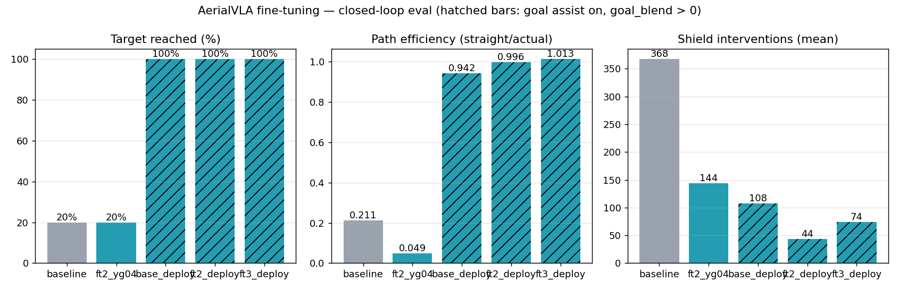
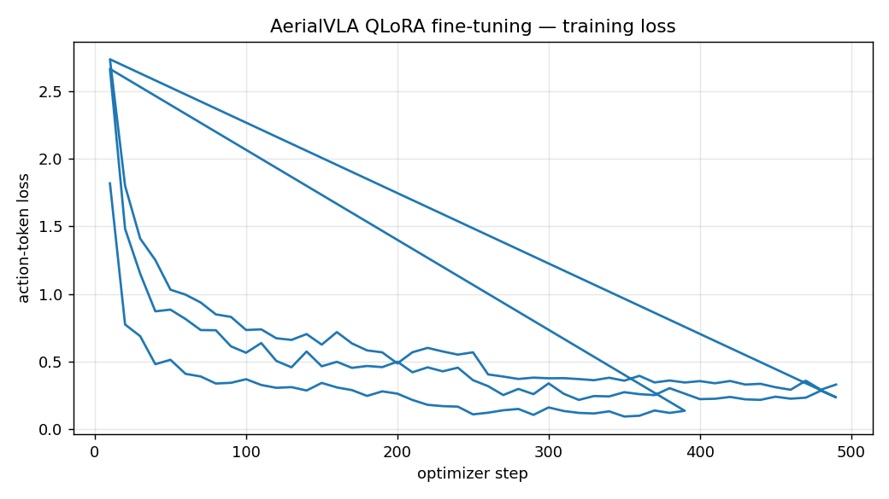

# AerialVLA Fine-Tuning Report — 2026-07-17

> **Corrected 2026-10-19.** The report of 2026-07-17 headed this table
> "pure VLA — goal assist OFF" and said every eval flight was pure VLA
> (`--goal-blend 0`); its chart said "no guidance assist" (withdrawn:
> CHANGELOG 2026-10-07, Retracted). base_deploy, ft2_deploy and ft3_deploy,
> the three 100 % rows, flew with goal_blend 0.55
> (`training/ft_campaign_stage2.ps1`); without the assist the adapters reached
> 1 of 5 (baseline, ft2_yg04) and 0 of 5 (ft2_e1,
> `training/eval_ft2_e1.json`). The table and chart below were rebuilt from the
> same eval files by the corrected `training/ft_report.py`, which reads each
> row's goal_blend from the episodes' recorded params; no number changed.

Base: openvla-7b (4-bit NF4) + AerialVLA LoRA (r=64), fine-tuned with QLoRA on self-collected AirSimNH expert flights (front+down mosaic, semantic-direction prompt, 99-bin action text).

## Closed-loop evaluation (how each row flew is in its own columns)

| adapter | episodes | goal_blend | yaw gain | flown as | reached | mean efficiency | mean interventions | NFZ s |
|---|---|---|---|---|---|---|---|---|
| baseline | 5 | 0 | 1 | pure VLA | 20% | 0.211 | 367.6 | 0.0 |
| ft2_yg04 | 5 | 0 | 0.4 | pure VLA | 20% | 0.049 | 144.2 | 0.0 |
| base_deploy | 5 | 0.55 | 0.4 | assisted | 100% | 0.942 | 108.0 | 0.0 |
| ft2_deploy | 5 | 0.55 | 0.4 | assisted | 100% | 0.996 | 43.6 | 0.0 |
| ft3_deploy | 5 | 0.55 | 0.4 | assisted | 100% | 1.013 | 73.8 | 0.0 |

## Training loss

## Notes
- `goal_blend` is the mission-direction assist of `demo/aerialvla_demo.py`:
  it mixes that share of a velocity toward the target into the VLA's
  horizontal action. It and the yaw gain are read from every episode's
  recorded `params`. A row with goal_blend above 0 is ASSISTED: its score
  is not the model's alone.
- Flown as pure VLA (goal_blend 0): baseline, ft2_yg04.
- Flown with the goal assist: base_deploy, ft2_deploy, ft3_deploy. Compare a reached rate only with rows flown the same way.
- The NFZ column is the time inside the no-fly zone; keeping the aircraft
  out of it is the guardrail's job in every configuration.